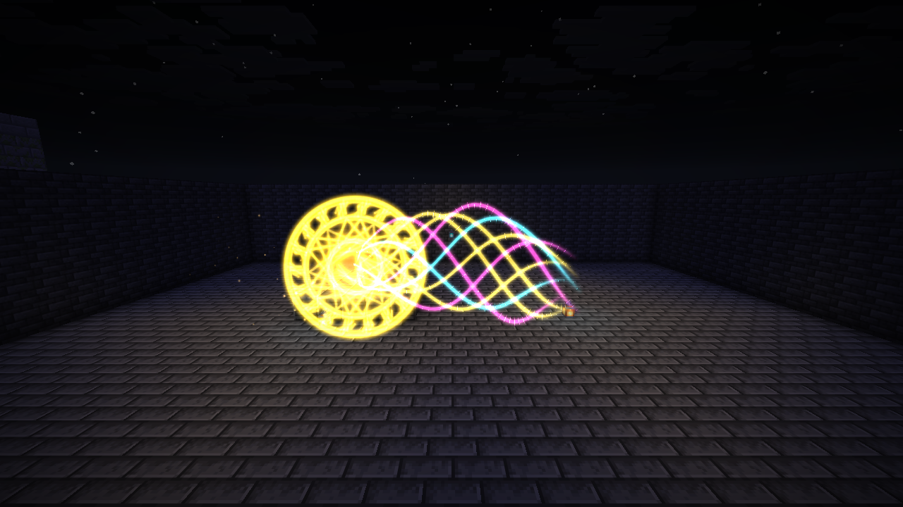
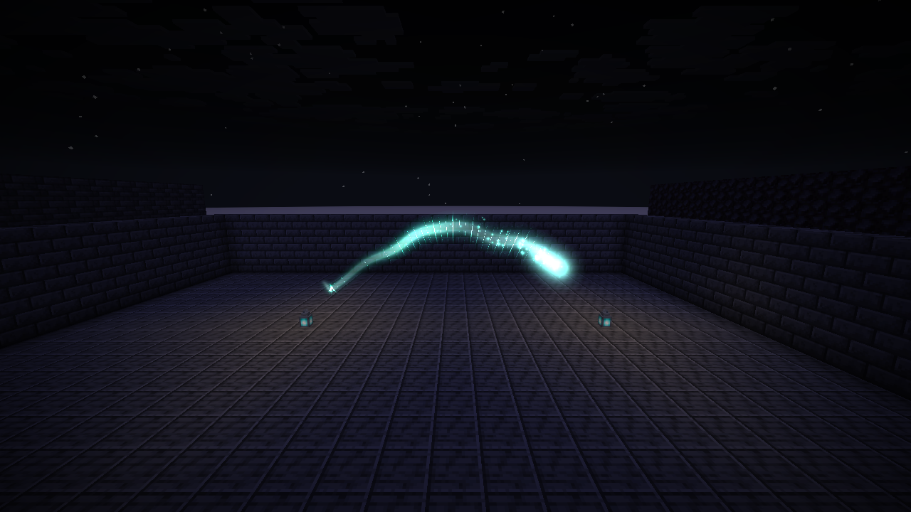

<p align="center">
  
</p>

<h1 align="center">LumenFX</h1>

<p align="center">
  <strong>Resource-driven cross-engine VFX runtime for Minecraft — supporting Unity ParticleSystem, Unreal Engine Niagara, and Photon <code>.fx</code> with dynamic Vulkan / OpenGL rendering.</strong>
</p>

<p align="center">
  <strong>English</strong> | <a href="README_zh.md">简体中文</a> | <a href="https://github.com/kltyton/LumenFX/wiki">Wiki</a>
</p>

---

## Fork Relationship & Origin

**LumenFX is a fork of [Photon](https://github.com/Low-Drag-MC/Photon) (Photon 26.2 by [KilaBash](https://github.com/KilaBash) / Low-Drag-MC).**

Building upon Photon's particle simulation core, timelines, curves, and `.fx` playback foundation, LumenFX restructures and extends the runtime into a **lightweight, standalone, resource-driven client VFX library** with:

- **Zero heavy external dependencies & no in-game editor in the runtime JAR** — runs completely standalone with no required `LDLib2` or `KilaGraph` installation (KilaGraph shader-graph playback remains available as optional soft-compat), and ships no demo assets or editor UI inside runtime JARs.
- **Multi-engine asset support & creator editor plugins** — runs native LumenFX JSON effects, Photon `.fx` effects, offline-exported **Unity ParticleSystem (Shuriken)** assets (via the included **Unity UPM Editor Plugin**), and offline-compiled **Unreal Engine Niagara** systems (CPU VectorVM, GPU SPIR-V compute, and SimCache `.lfsc`, via the included **UE5 Editor Plugin** & CLI compiler).
- **GeckoLib (4.x / 5.x) & KBR particle keyframe compatibility** — play LumenFX effects directly from Blockbench `particle_effects` keyframes with 3D locator position & rotation tracking across all 10 targets while peacefully coexisting with KBR SnowStorm / Bedrock particles.
- **Unified multi-version & multi-loader architecture** — ships a single unified mod JAR per target across Minecraft **1.20.1, 1.21.1, 26.1.2, 26.2, and 26.3** (Forge, NeoForge, and Fabric), with **dynamic Vulkan-first / OpenGL fallback on 26.2 & 26.3** and a full-feature native OpenGL runtime on 1.20.1, 1.21.1, and 26.1.2.

Photon-derived source files retain KilaBash's attribution and are governed by the bundled [Photon License (CC BY-NC-SA 4.0)](licenses/photon/LICENSE). Original LumenFX code and offline authoring tools are licensed under [MIT](LICENSE).

---

## Showcase

All screenshots below were captured live in-game using LumenFX's native runtime — **no shader pack required**.

| Arcane Rune Circle & Multi-Ribbon Trails | Astral Vortex Portal |
| :---: | :---: |
|  |  |

| Built-in Bloom Fireball & Rising Embers | Custom GLSL Shader Plasma Trail |
| :---: | :---: |
|  |  |

<p align="center">
  <br/>
  <em>Gravity-arcing luminous particle jet & ground splash</em>
</p>

---

## Key Features

- **Cross-Engine VFX Runtime**: Plays native LumenFX JSON effects, Photon `.fx` files, Unity ParticleSystem exports, and Unreal Engine Niagara CPU/GPU systems & SimCaches through one unified Java API (`VfxEffects`).
- **Rich Renderers, Built-in HDR Bloom & Full Native OpenGL Parity**: Supports Sprites (Billboard, Stretched, Horizontal/Vertical), Ribbons (Catmull–Rom & Hermite curves with adaptive subdivision), Beams, 3D Meshes, Nanite cluster LOD meshes, 3D Gaussian Splatting, Runtime Virtual Textures (RVT), Groom hair strands, Volumetric Fog/Materials, Deferred Decals, Dynamic Point/Spot Lights, Depth Soft Particles, and 3D OpenAL Spatial Audio — with built-in HDR Bloom across every supported Minecraft version (1.20.1 through 26.3).
- **Zero-Readback GPU Niagara & Custom GLSL Materials**: Renders GPU-simulated Niagara emitters directly from OpenGL/Vulkan storage buffers with GPU distance sorting and no CPU readback cap, alongside custom GLSL fragment/vertex shaders (`assets/<namespace>/shaders/vfx/*.fsh`) with multi-texture samplers, scene depth/color access, and full blend/depth control.
- **Dynamic Graphics Backend (Minecraft 26.2 & 26.3)**:
  - Each target ships as a **single unified JAR** (no separate Vulkan vs. OpenGL downloads) with lossless compute-shader packaging (`compute.lfpack`) that keeps download size compact while preserving resource-pack overrides.
  - Defaults to **Vulkan** when the system driver and active rendering mods support it (including standalone and Sodium).
  - Automatically falls back to **OpenGL** when Vulkan is unavailable or when an OpenGL-only rendering mod (such as Iris) is active.
  - Always respects explicit user overrides (`--graphicsBackend`, in-game video settings, and vanilla crash recovery).
- **Optional Mod Compatibility**: Runs completely standalone with zero required dependencies (no mandatory LDLib2, KilaGraph, Iris, Sodium, GeckoLib, or KBR); offers automatic optional soft-compatibility with **Iris**, **Sodium**, **GeckoLib 4.x / 5.x**, **KBR (KltytonBedrockRuntime)**, and **KilaGraph**.
- **GeckoLib & KBR Particle Keyframes**: Trigger LumenFX effects straight from Blockbench animation `particle_effects` keyframes with automatic ID routing, 3D locator position/rotation tracking, `pre_effect_script` options (`follow`, `rotate`, `scale`, `color`, `offset`, `beam_end`, `stop`, `restart`, `seed`), and the `LumenFxKeyframeBridge` Java API.
- **Lock-Free Work-Stealing Multi-Threaded Simulation**: Runs emitter simulation on persistent lock-free worker pools with workload-balanced LPT scheduling, owner-thread overlap, pre-compiled Niagara parameter bindings, hoisted VectorVM execution, and ring-buffered GPU uploads.

---

## Supported Versions & Loaders

| Minecraft | Loader | Maven Artifact ID | Java | Graphics Backend |
| :---: | :---: | :--- | :---: | :--- |
| **26.3** | NeoForge | `lumenfx-neoforge-26.3` | Java 25 | Dynamic Vulkan-first / OpenGL fallback |
| **26.3** | Fabric | `lumenfx-fabric-26.3` | Java 25 | Dynamic Vulkan-first / OpenGL fallback |
| **26.2** | NeoForge | `lumenfx-neoforge-26.2` | Java 25 | Dynamic Vulkan-first / OpenGL fallback |
| **26.2** | Fabric | `lumenfx-fabric-26.2` | Java 25 | Dynamic Vulkan-first / OpenGL fallback |
| **26.1.2** | NeoForge | `lumenfx-neoforge-26.1.2` | Java 25 | Native OpenGL (Full Feature Parity) |
| **26.1.2** | Fabric | `lumenfx-fabric-26.1.2` | Java 25 | Native OpenGL (Full Feature Parity) |
| **1.21.1** | NeoForge | `lumenfx-neoforge-1.21.1` | Java 21 | Native OpenGL (Full Feature Parity) |
| **1.21.1** | Fabric | `lumenfx-fabric-1.21.1` | Java 21 | Native OpenGL (Full Feature Parity) |
| **1.20.1** | Forge | `lumenfx-forge-1.20.1` | Java 17 | Native OpenGL (Full Feature Parity) |
| **1.20.1** | Fabric | `lumenfx-fabric-1.20.1` | Java 17 | Native OpenGL (Full Feature Parity) |

---

## Developer Quick Start

### 1. Add Maven Dependency

LumenFX artifacts are hosted on **Sighs Maven**:

```groovy
repositories {
    maven {
        name = 'Sighs Maven'
        url = uri('https://maven.sighs.cc/repository/maven-public/')
    }
}

dependencies {
    // Replace with your target artifact ID from the table above
    implementation 'com.kltyton.lumenfx:lumenfx-neoforge-26.3:0.3.0'
}
```

### 2. Spawn & Control Effects in Java

```java
EffectHandle effect = VfxEffects.spawn(
        clientLevel,
        Identifier.parse("my_mod:magic/trail"),
        position,
        seed
);

effect.moveTo(nextPosition);
// Optional: use setPose(position, quaternion, scale) or setColor(r, g, b, a)
// Optional: call trackRenderSamples() once for render-driven anchor updates
// Optional: setBeamEnd(targetPos) for Beam emitters

if (!effect.isAlive()) {
    // Effect finished naturally or was invalidated by resource reload / level change
}

effect.close(); // Stops new emission and lets existing particles finish gracefully
```

Effect ID `my_mod:magic/trail` resolves to `assets/my_mod/lumenfx/effects/magic/trail.json` (or `.fx` for Photon assets).

---

## Documentation & Offline Authoring Tools

- **[GitHub Wiki](https://github.com/kltyton/LumenFX/wiki)** (also mirrored in [`docs/wiki/`](docs/wiki/Home.md)):
  - [Getting Started & API](docs/wiki/Getting-Started.md)
  - [Effect JSON & GLSL Reference](docs/wiki/Effect-Format-Reference.md)
  - [Niagara, Unity & Photon Workflow](docs/wiki/Niagara-and-Unity-Workflow.md)
  - [GeckoLib & KBR Particle Keyframes](docs/wiki/GeckoLib-and-KBR-Keyframes.md)
  - [Graphics Backends & Compatibility](docs/wiki/Graphics-Backends-and-Compatibility.md)
  - [Fork Relationship & Licensing](docs/wiki/Fork-and-Licensing.md)
- **Offline Creator Plugins & Compilers** (never bundled into runtime mod JARs):
  - [Unity UPM Editor Plugin](tools/unity/README.md) (`com.kltyton.lumenfx.exporter`) — Install via Unity Package Manager; includes creator presets, Minecraft 1-block grid guides, inline validation, batch export, URP Shader Graph compilation, and optional `pack.mcmeta` export.
  - [Unreal Engine 5 Editor Plugin](tools/unreal/LumenFxExporter/README.md) (`LumenFxExporter.uplugin`) — Content Browser right-click export on `UNiagaraSystem` assets with Project Settings, pre-export validation, and async compiler runner.
  - [Unreal Engine Niagara Compiler](tools/compiler/README.md) — Offline compiler for Niagara CPU VectorVM, GPU compute shaders, materials, vector fields, and SimCaches.

---

## Building from Source

```powershell
# Build the default target (neoforge-26.2)
.\gradlew.bat --no-daemon --console=plain build

# Or build a specific target directory (e.g. fabric-26.2, neoforge-1.21.1, forge-1.20.1)
cd targets\fabric-26.2
.\gradlew.bat --no-daemon --console=plain build
```

---

## Licensing & Attribution

- **LumenFX Original Code & Offline Tools**: Licensed under the [MIT License](LICENSE).
- **Photon-Derived Runtime Code**: Forked from [Photon](https://github.com/Low-Drag-MC/Photon) (Photon 26.2 by **KilaBash** / Low-Drag-MC) and distributed under the [Creative Commons Attribution-NonCommercial-ShareAlike 4.0 International License (CC BY-NC-SA 4.0)](licenses/photon/LICENSE). Please review the Photon license terms regarding attribution and non-commercial redistribution.
- **Expression Parser (`expr`)**: Uses Darius Bacon's expression implementation under [licenses/expr/COPYING](licenses/expr/COPYING).
- **Third-Party Assets & Engine Components**: Retain their respective original licenses.
