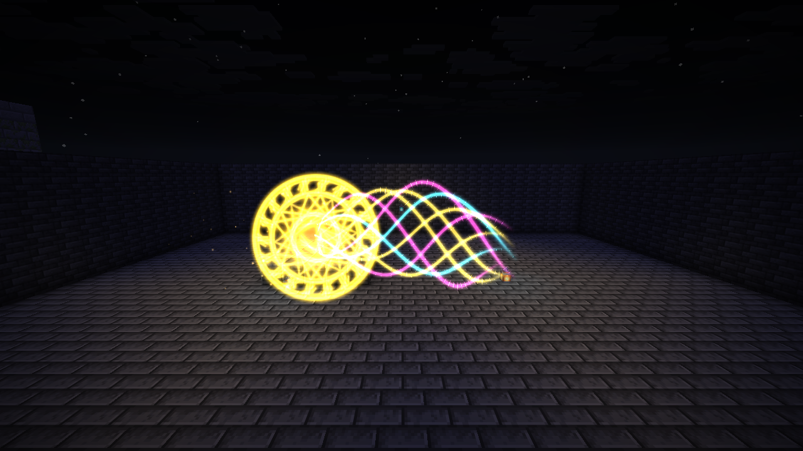
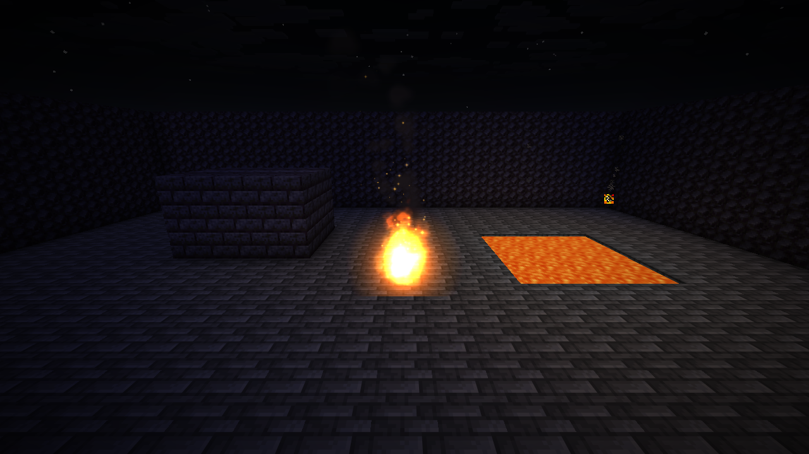
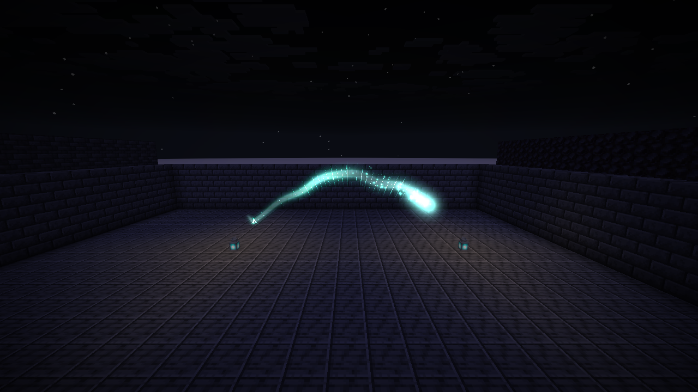
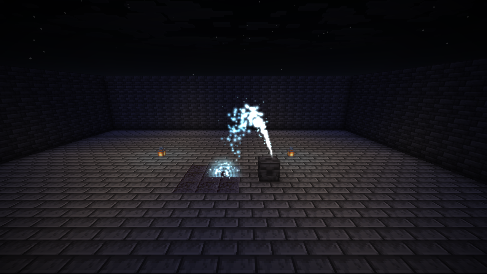

<p align="center">
  
</p>

<h1 align="center">LumenFX</h1>

<p align="center">
  <strong>面向 Minecraft 的资源驱动跨引擎粒子特效运行库——原生支持 Unity ParticleSystem、Unreal Engine Niagara 与 Photon <code>.fx</code>，并在 26.2 提供动态 Vulkan / OpenGL 自动渲染。</strong>
</p>

<p align="center">
  <a href="README.md">English</a> | <strong>简体中文</strong> | <a href="https://github.com/kltyton/LumenFX/wiki/Home-zh">中文 Wiki 文档</a>
</p>

---

## 分支关系与项目渊源

**LumenFX 是 [Photon](https://github.com/Low-Drag-MC/Photon)（[KilaBash](https://github.com/KilaBash) / Low-Drag-MC 著作的 Photon 26.2）的独立衍生分支（Fork）。**

在继承 Photon 粒子模拟核心、时间线、曲线与 `.fx` 特效播放能力的基础上，LumenFX 将运行层重构并扩展为**超轻量、零强制外部依赖、纯资源驱动的客户端 VFX 运行库**：

- **极致轻量、无重型外部前置与游戏内编辑器**——彻底解耦外部 `LDLib2` 与 `KilaGraph` 强依赖（KilaGraph 着色器图仍以纯可选软兼容方式保留），运行 JAR 不含编辑器、演示贴图或重复冗余文件，所有特效均以标准 Minecraft 资源包形式加载（`assets/<namespace>/lumenfx/...`）。
- **跨引擎资产兼容与前端编辑器插件**——同时运行 LumenFX 原生 JSON、Photon `.fx`、**Unity ParticleSystem（Shuriken）**（配套标准 **Unity UPM 编辑器插件**）与 **Unreal Engine Niagara**（CPU VectorVM、GPU SPIR-V 计算与 SimCache `.lfsc`，配套 **UE5 编辑器插件** 与离线编译器）。
- **原生软兼容 GeckoLib（4.x / 5.x）与 KBR 粒子关键帧系统**——全部 10 个目标均可在 Blockbench 动画 `particle_effects` 关键帧中直接触发 LumenFX 粒子与拖尾，支持 3D 定位点位置与旋转跟随，并与 KBR 原生暴雪/3D 粒子和平共存。
- **多版本多加载器统一交付**——完整覆盖 Minecraft **1.20.1、1.21.1、26.1.2、26.2 与 26.3**（Forge、NeoForge、Fabric），每个目标仅交付单一统一 JAR；26.2 与 26.3 提供**动态 Vulkan 优先 / OpenGL 自动回退**，1.20.1 / 1.21.1 / 26.1.2 提供全特性原生 OpenGL 管线。

源自 Photon 26.2 的代码文件完整保留 KilaBash 的署名与版权声明，遵循随附的 [Photon 许可证（CC BY-NC-SA 4.0）](licenses/photon/LICENSE)；LumenFX 原创代码与离线工具采用 [MIT 许可证](LICENSE)。

---

## 实机特效展示

以下所有画面均由 LumenFX 在游戏内实时渲染截屏——**无需安装任何光影模组即可呈现泛光与自定义着色器效果**。

| 符文光环与多色螺旋丝带拖尾 | 星界能量漩涡（末地传送门祭坛） |
| :---: | :---: |
|  |  |

| 内置泛光炽焰火球与火星烟雾 | 自定义 GLSL 着色器翡翠等离子彗尾 |
| :---: | :---: |
|  |  |

<p align="center">
  <br/>
  <em>重力抛物线物理光泉与地面溅射环</em>
</p>

---

## 核心特性

- **跨引擎统一运行时**：单一公共 Java API（`VfxEffects`）即可播放 LumenFX JSON、Photon `.fx`、Unity ParticleSystem 导出资源及 Unreal Engine Niagara CPU/GPU 与 SimCache 特效。
- **丰富渲染模式、内置 HDR 泛光与全版本原生 OpenGL 对等管线**：全版本（1.20.1–26.3）支持精灵（公告板 / 速度拉伸 / 水平 / 垂直）、丝带拖尾、光束（Beam）、3D 网格、Nanite 簇级 LOD 网格、3D 高斯泼溅（Gaussian Splatting）、运行时虚拟纹理（RVT）、Groom 毛发发丝、体积雾与体积材质、延迟贴花、动态点光源/聚光灯、深度软粒子及 3D OpenAL 空间音频，无需光影即可呈现 HDR 泛光。
- **Niagara GPU 零回读直出与自定义 GLSL 材质**：GPU 模拟的 Niagara 粒子直接从 OpenGL/Vulkan 存储缓冲渲染并进行 GPU 距离排序（无 CPU 回读上限）；支持自定义 GLSL 片元/顶点着色器（`assets/<namespace>/shaders/vfx/*.fsh`）、多纹理采样器、场景深度/颜色采样与完整混合/深度控制。
- **动态图形后端自适应与无损着色器打包（Minecraft 26.2 & 26.3）**：
  - 每个版本目标仅发布**单一统一 JAR**，采用无损计算着色器打包（`compute.lfpack`）显著缩小包体并完整支持资源包覆盖；
  - 当系统显卡驱动及已装渲染模组支持 Vulkan 时（包含独立运行与 Sodium 共装），**默认自动启用 Vulkan**；
  - 当环境不支持 Vulkan 或检测到必须使用 OpenGL 的渲染模组（如 Iris）时，**自动无缝回退至 OpenGL**；
  - 始终尊重用户的显式图形后端参数（`--graphicsBackend`）、视频设置及原版崩溃恢复。
- **零强制前置，全可选软兼容**：完全独立运行，不强制依赖 LDLib2、KilaGraph、Iris、Sodium、GeckoLib 或 KBR；共装时自动启用对应可选兼容路径。
- **GeckoLib 与 KBR 粒子关键帧兼容**：直接在 Blockbench 动画的 `particle_effects` 关键帧中触发 LumenFX 特效，自动按 ID 分流（未命中时交还 KBR 原生暴雪/3D 粒子），支持 3D 定位点位置/旋转跟随、`pre_effect_script` 参数指令与 `LumenFxKeyframeBridge` 公开 Java API。
- **无锁工作窃取多线程模拟与零拷贝 GPU 上传**：全版本采用持久化无锁工作窃取线程池、LPT 负载排序、主线程重叠调度、预编译 Niagara 参数绑定、指令提升 VectorVM 与多帧环形缓冲直写。

---

## 支持版本与加载器

| Minecraft 版本 | 加载器 | Maven Artifact ID | Java 版本 | 图形后端策略 |
| :---: | :---: | :--- | :---: | :--- |
| **26.3** | NeoForge | `lumenfx-neoforge-26.3` | Java 25 | 动态 Vulkan 优先 / OpenGL 自动回退 |
| **26.3** | Fabric | `lumenfx-fabric-26.3` | Java 25 | 动态 Vulkan 优先 / OpenGL 自动回退 |
| **26.2** | NeoForge | `lumenfx-neoforge-26.2` | Java 25 | 动态 Vulkan 优先 / OpenGL 自动回退 |
| **26.2** | Fabric | `lumenfx-fabric-26.2` | Java 25 | 动态 Vulkan 优先 / OpenGL 自动回退 |
| **26.1.2** | NeoForge | `lumenfx-neoforge-26.1.2` | Java 25 | 原生 OpenGL（全特性对等管线） |
| **26.1.2** | Fabric | `lumenfx-fabric-26.1.2` | Java 25 | 原生 OpenGL（全特性对等管线） |
| **1.21.1** | NeoForge | `lumenfx-neoforge-1.21.1` | Java 21 | 原生 OpenGL（全特性对等管线） |
| **1.21.1** | Fabric | `lumenfx-fabric-1.21.1` | Java 21 | 原生 OpenGL（全特性对等管线） |
| **1.20.1** | Forge | `lumenfx-forge-1.20.1` | Java 17 | 原生 OpenGL（全特性对等管线） |
| **1.20.1** | Fabric | `lumenfx-fabric-1.20.1` | Java 17 | 原生 OpenGL（全特性对等管线） |

---

## 开发者快速上手

### 1. 添加 Maven 依赖

LumenFX 发布于 **Sighs Maven**：

```groovy
repositories {
    maven {
        name = 'Sighs Maven'
        url = uri('https://maven.sighs.cc/repository/maven-public/')
    }
}

dependencies {
    // 按需替换为上表中对应版本与加载器的 Artifact ID
    implementation 'com.kltyton.lumenfx:lumenfx-neoforge-26.3:0.3.0'
}
```

### 2. 在 Java 代码中生成与控制特效

```java
EffectHandle effect = VfxEffects.spawn(
        clientLevel,
        Identifier.parse("my_mod:magic/trail"),
        position,
        seed
);

effect.moveTo(nextPosition);
// 可选：setPose(position, quaternion, scale) 设置位置/旋转/缩放，setColor(r, g, b, a) 设置染色乘数
// 可选：由渲染器定位点驱动时调用一次 trackRenderSamples()
// 可选：Beam 光束特效可通过 setBeamEnd(targetPos) 设置世界终点

if (!effect.isAlive()) {
    // 特效已自然结束，或因切换维度 / 资源重载而失效
}

effect.close(); // 停止新粒子发射，让已有粒子自然播放完毕后回收
```

效果 ID `my_mod:magic/trail` 会自动解析至 `assets/my_mod/lumenfx/effects/magic/trail.json`（或 Photon `.fx` 资产）。

---

## 文档与离线制作工具

- **[GitHub 中文 Wiki 完整文档](https://github.com/kltyton/LumenFX/wiki/Home-zh)**（同步存档于 [`docs/wiki/`](docs/wiki/Home-zh.md)）：
  - [快速入门与 API 指南](docs/wiki/Getting-Started-zh.md)
  - [效果 JSON 与自定义 GLSL 材质参考](docs/wiki/Effect-Format-Reference-zh.md)
  - [Niagara、Unity 与 Photon 工作流](docs/wiki/Niagara-and-Unity-Workflow-zh.md)
  - [GeckoLib 与 KBR 粒子关键帧集成](docs/wiki/GeckoLib-and-KBR-Keyframes-zh.md)
  - [图形后端与模组兼容说明](docs/wiki/Graphics-Backends-and-Compatibility-zh.md)
  - [Photon 分支关系与开源许可说明](docs/wiki/Fork-and-Licensing-zh.md)
- **离线编辑器插件与编译工具**（不会打包进游戏运行 JAR）：
  - [Unity UPM 编辑器插件](tools/unity/README.md)（`com.kltyton.lumenfx.exporter`）— 支持 Unity Package Manager 直接安装，提供预设模板、Minecraft 1 格参考网格、窗口内联校验、批量导出、URP Shader Graph 编译及可选 `pack.mcmeta` 生成。
  - [Unreal Engine 5 编辑器插件](tools/unreal/LumenFxExporter/README_zh.md)（`LumenFxExporter.uplugin`）— 内容浏览器右键 `UNiagaraSystem` 直接导出，内置项目设置、导出前校验与异步编译进度面板。
  - [Unreal Engine Niagara 离线转换器](tools/compiler/README.md) — 离线编译 Niagara CPU VectorVM、GPU 计算着色器、材质图、向量场与 SimCache。

---

## 从源码构建

```powershell
# 构建默认目标（neoforge-26.2）
.\gradlew.bat --no-daemon --console=plain build

# 或进入指定目标目录单独构建（如 fabric-26.2、neoforge-1.21.1、forge-1.20.1）
cd targets\fabric-26.2
.\gradlew.bat --no-daemon --console=plain build
```

---

## 开源许可与鸣谢

- **LumenFX 原创代码与离线工具**：采用 [MIT 许可证](LICENSE)。
- **源自 Photon 的运行层代码**：衍生自 **KilaBash** / Low-Drag-MC 开发的 [Photon](https://github.com/Low-Drag-MC/Photon)（Photon 26.2），依据 [知识共享署名-非商业性使用-相同方式共享 4.0 国际许可协议（CC BY-NC-SA 4.0）](licenses/photon/LICENSE) 分发，请在二次分发与衍生使用时严格遵守署名与非商业条款。
- **数学表达式解析器（`expr`）**：采用 Darius Bacon 的表达式实现，遵循 [licenses/expr/COPYING](licenses/expr/COPYING)。
- **第三方资源与引擎组件**：沿用各自的原始许可协议。
