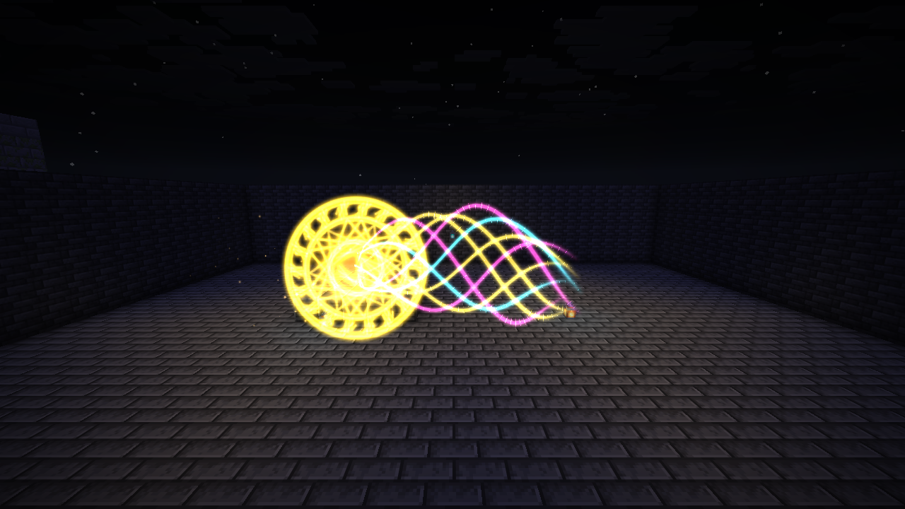
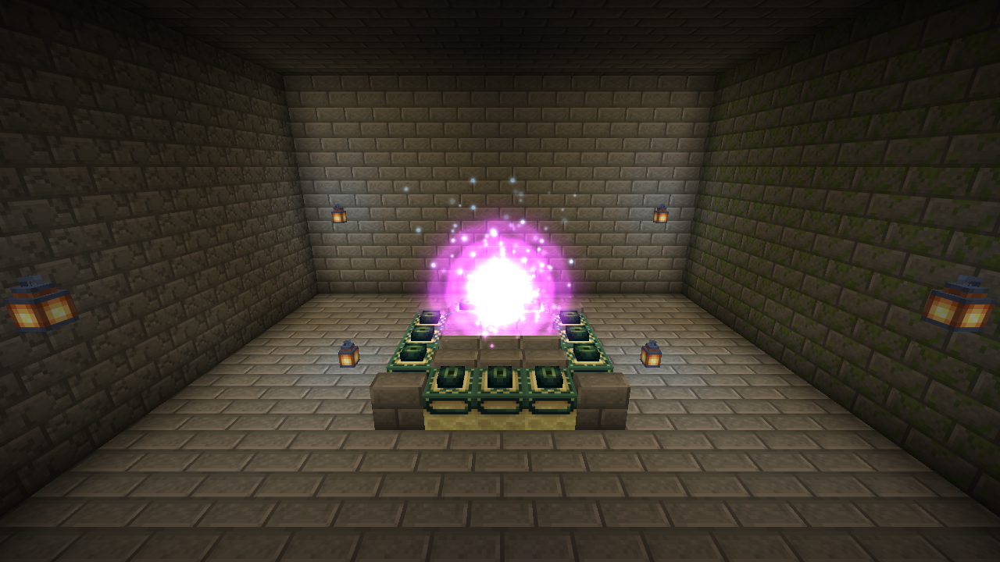
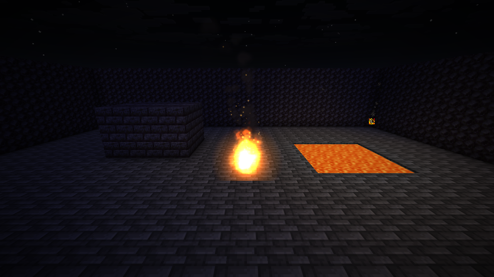
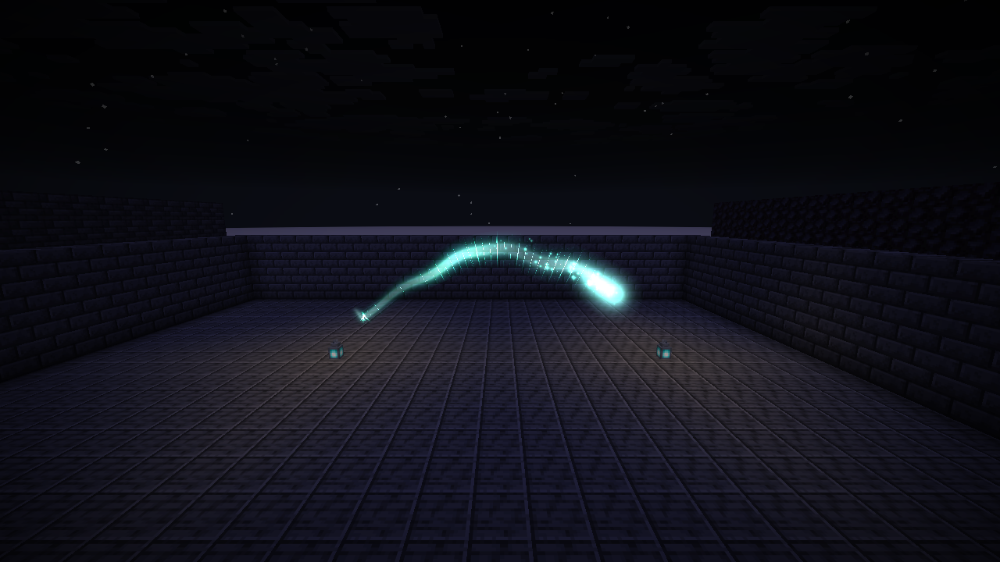
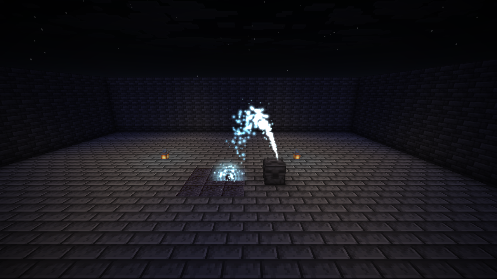

<!-- ====================================================================== -->
<!-- ONE-SENTENCE ABOUT / SUMMARY (Paste into CurseForge Summary field)     -->
<!-- ====================================================================== -->
<!--
A lightweight Photon fork bringing Unity, Unreal Niagara, and custom GLSL particle VFX to Minecraft with automatic Vulkan/OpenGL support.
-->

# ✨ LumenFX

**A lightweight, resource-driven next-gen VFX runtime for Minecraft — bringing Unity ParticleSystem, Unreal Engine Niagara, and Photon `.fx` effects to life with built-in bloom, custom shaders, and automatic Vulkan / OpenGL rendering.**

> **About the Fork:** LumenFX is a fork of **[Photon](https://github.com/Low-Drag-MC/Photon)** (Photon 26.2 by **KilaBash** / Low-Drag-MC), rebuilt into a clean, editor-free client VFX runtime supporting Minecraft **1.20.1, 1.21.1, 26.1.2, and 26.2** across **Forge, NeoForge, and Fabric**.

---

## 🌟 Visual Showcase

*Every screenshot below was captured directly in-game using LumenFX's native renderer — **no shader mod required!***

### 🔮 Arcane Rune Circles & Multi-Ribbon Trails
Weave smooth, multi-layered glowing ribbons, orbital curves, and intricate rune rings directly in the world.

### 🌌 Volumetric Astral Portals & Energy Vortices
Bring boss arenas, portals, and magical altars alive with layered additive glow, radial energy rings, and dynamic light.

### 🔥 Built-in Bloom Effects (No Shader Mod Required)
Incandescent fireballs, rising ember plumes, and soft HDR-style glow work out of the box on vanilla graphics — and stay compatible when you do install shaders!

### 🎨 Custom GLSL Shader Materials
Mod authors and resource-pack creators can drive fully custom fragment shaders for animated plasma trails, energy distortions, and procedural patterns.

### 💧 Real-Time Particle Physics & Gravity Simulation
Support for gravity arcs, velocity/force curves, drag, curl noise, and ground splashes powered by bounded multi-threaded simulation.

---

## ⚡ Why Players & Modpack Makers Love LumenFX

- **One Unified Download — Zero Backend Headaches (26.2):** No separate "Vulkan edition" or "OpenGL edition" to worry about! On Minecraft 26.2, LumenFX automatically uses **Vulkan** when your GPU and mod list support it, and seamlessly falls back to **OpenGL** when needed (such as on older drivers or with OpenGL-only shader mods).
- **Works Completely Standalone:** Requires no other rendering mods to run.
- **Iris & Sodium Compatible:** Optional compatibility with **Iris**, **Sodium**, and **KBR** — drop LumenFX into your favorite performance or shader modpack with confidence.
- **Lightweight Runtime Only:** No heavy in-game editor UI bundled into the JAR, keeping memory usage low and gameplay smooth.
- **Cross-Engine Power for Mod Authors:** Runs native LumenFX JSON effects, legacy **Photon `.fx`** assets, offline-exported **Unity ParticleSystem (Shuriken)** hierarchies, and offline-compiled **Unreal Engine Niagara** (CPU VectorVM, GPU compute, and SimCache) systems.

---

## 📦 Supported Versions & Loaders

| Minecraft | Mod Loaders | Rendering Backend |
| :---: | :---: | :--- |
| **26.2** | NeoForge, Fabric | Dynamic Vulkan-first / Automatic OpenGL fallback |
| **26.1.2** | NeoForge, Fabric | OpenGL |
| **1.21.1** | NeoForge, Fabric | OpenGL |
| **1.20.1** | Forge, Fabric | OpenGL |

---

## 🛠️ For Mod Developers & Creators

- **GitHub Source & Offline Exporters (Unity & Unreal Niagara):** [github.com/kltyton/LumenFX](https://github.com/kltyton/LumenFX)
- **Full Wiki & Java API Documentation:** [github.com/kltyton/LumenFX/wiki](https://github.com/kltyton/LumenFX/wiki)
- **Maven Repository (Sighs Maven):** `https://maven.sighs.cc/repository/maven-public/` (`com.kltyton.lumenfx:lumenfx-<loader>-<mc_version>:0.1.3`)

---

## 📜 Credits & Licensing

- **Forked from [Photon](https://github.com/Low-Drag-MC/Photon)** (Photon 26.2) by **KilaBash** / Low-Drag-MC.
- Photon-derived runtime code is distributed under **CC BY-NC-SA 4.0** (see bundled `licenses/photon/LICENSE`). Original LumenFX code and offline tools are licensed under **MIT**.
- Feel free to include LumenFX in non-commercial modpacks!
