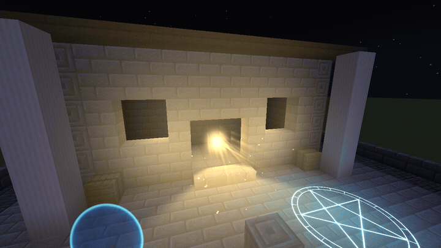
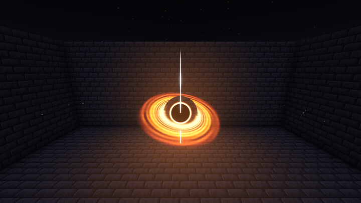
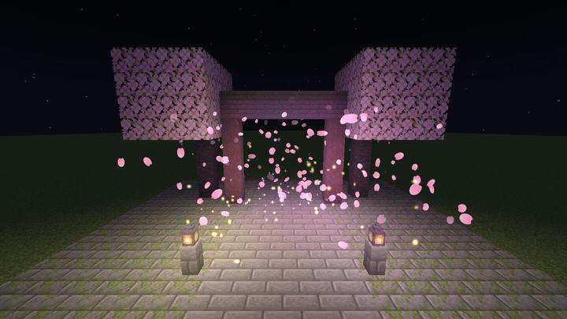

<!-- ====================================================================== -->
<!-- ONE-SENTENCE ABOUT / SUMMARY (Paste into CurseForge Summary field)     -->
<!-- ====================================================================== -->
<!--
A lightweight Photon fork bringing Unity, Unreal Niagara, dynamic lights, volumetric fog, and custom GLSL particle VFX to Minecraft with automatic Vulkan/OpenGL support.
-->

# ✨ LumenFX

**A lightweight, resource-driven next-gen VFX runtime for Minecraft — bringing Unity ParticleSystem, Unreal Engine Niagara, Photon `.fx`, dynamic lights, volumetric fog, 3D mesh swarms, and custom GLSL shaders to life with built-in HDR bloom and automatic Vulkan / OpenGL rendering.**

> **About the Fork:** LumenFX is a fork of **[Photon](https://github.com/Low-Drag-MC/Photon)** (Photon 26.2 by **KilaBash** / Low-Drag-MC), rebuilt into a clean, editor-free client VFX runtime supporting Minecraft **1.20.1, 1.21.1, 26.1.2, 26.2, and 26.3** across **Forge, NeoForge, and Fabric**.

---

## 🌟 Visual Showcase

*All 10 live animated captures below were captured live in-game using LumenFX's native renderer — **no shader mod required!** Every effect is also available in the official [`examples/showcase-pack`](https://github.com/kltyton/LumenFX/tree/main/examples/showcase-pack) resource pack.*

### 💡 Dynamic Point & Spot Lights
Real-time colored point and spot lights that illuminate blocks, pillars, and world geometry — paired with glowing Fresnel orbs, vertical light beams, and pentagram magic seals.

### 🌫️ Volumetric Lights & Fog Volumes
3D raymarched fog volumes, warm interior point/spot lights, and depth-soft volumetric light shafts streaming through temple doorways with illuminated dust motes.

### 🎨 All-in-One Procedural VFX Materials (Custom GLSL)
Drive custom fragment shaders for cel-shaded toon fireballs, crisp HDR energy rings, crackling lightning arcs, translucent Fresnel forcefields, swirling astral vortices, cellular dissolve cores, organic flames, and glowing ground sigils.

### 💥 Real-Time Particle Collision
Gravity-driven sparkle showers colliding against real Minecraft stairs, slabs, and walls — bouncing, damping, cascading across every step, and spilling onto the grass.

### 🦊 3D Hologram Mesh Swarms
Render custom 3D `.lfmesh` and glTF models as particle swarms with animated horizontal hologram scanlines, edge glow, and dynamic ground lighting.

### 🕳️ Black Hole & Relativistic Accretion Disk
Combine opaque pitch-black event horizons, blazing Einstein photon rings, tilted swirling accretion disk shaders, relativistic polar jets, and orbiting star dust.

### 🔮 Arcane Mandala & Multi-Ribbon Trails
Weave smooth, multi-layered glowing ribbons, orbital curves, and double-layered rotating golden-cyan arcane hexagram seals directly in the world.

### ⚡ Orbital Plasma Cannon & Shockwave Impact
Sky-to-ground HDR plasma pillars with rising charge rings, expanding ground shockwave rings, deferred ground scorch decals, volumetric mist, and bouncing sparks.

### ❄️ Crystalline 3D Frost Nova
Erupting faceted 3D hexagonal ice crystal spires with translucent glacial Fresnel shading, glowing snowflake ground seals, cryogenic volumetric fog, and snowflakes.

### 🌸 Celestial Sakura & Golden Firefly Sanctuary
Noise-driven drifting cherry blossom petals, HDR glowing golden fireflies, multi-color localized dynamic lighting, and dreamy moonlit volumetric mist.

---

## ⚡ Why Players & Modpack Makers Love LumenFX

- **One Unified Download — Zero Backend Headaches (26.2 & 26.3):** No separate "Vulkan edition" or "OpenGL edition" to worry about! On Minecraft 26.2 and 26.3, LumenFX automatically uses **Vulkan** when your GPU and mod list support it, and seamlessly falls back to **OpenGL** when needed (such as on older drivers or with OpenGL-only shader mods), while lossless compute-shader packaging keeps JAR sizes compact.
- **Full Native OpenGL Feature Parity on 1.20.1, 1.21.1 & 26.1.2:** Every supported Minecraft version ships with built-in HDR Bloom, custom GLSL material shaders, depth soft particles, complete Photon `.fx` timelines/forcefields/collisions/sub-emitters, zero-readback GPU Niagara rendering (no particle count readback cap), Nanite cluster LOD meshes, 3D Gaussian Splatting, Runtime Virtual Textures (RVT), Groom hair strands, volumetric fog/decals/lights, and 3D OpenAL spatial audio.
- **High-Throughput Multi-Threaded Simulation:** Lock-free work-stealing worker pools with workload-balanced scheduling, pre-compiled Niagara parameter bindings, hoisted VectorVM execution, and ring-buffered GPU uploads keep frame pacing smooth across all 10 targets.
- **Lightweight Runtime:** Fabric builds require Fabric API for the matching Minecraft version. LDLib2 is optional. The runtime JAR ships without the in-game editor or demo assets. Optional soft-compatibility with **Iris**, **Sodium**, **GeckoLib (4.x / 5.x)**, **KBR**, and **KilaGraph** activates automatically when those mods are present.
- **GeckoLib & KBR Particle Keyframe Support:** Trigger LumenFX particles, ribbons, and trails directly from Blockbench `particle_effects` animation keyframes across all supported Minecraft versions — with 3D locator position & rotation tracking, `pre_effect_script` controls (`scale`, `color`, `offset`, `rotate`, `beam_end`, `stop`, etc.), and seamless coexistence with KBR Bedrock / SnowStorm particles.
- **Cross-Engine Power & Official Unity / UE5 Editor Plugins:** Runs native LumenFX JSON effects, **Photon `.fx`** assets, offline-exported **Unity ParticleSystem (Shuriken)** hierarchies (with a dedicated **Unity UPM Editor Plugin** featuring presets, MC 1-block guides, and batch export), and offline-compiled **Unreal Engine Niagara** systems (CPU VectorVM, GPU compute, and SimCache, with a dedicated **UE5 `.uplugin` Editor Plugin** & CLI compiler).

---

## 📦 Supported Versions & Loaders

| Minecraft | Mod Loaders | Rendering Backend |
| :---: | :---: | :--- |
| **26.3** | NeoForge, Fabric | Dynamic Vulkan-first / Automatic OpenGL fallback |
| **26.2** | NeoForge, Fabric | Dynamic Vulkan-first / Automatic OpenGL fallback |
| **26.1.2** | NeoForge, Fabric | Native OpenGL (Full Feature Parity) |
| **1.21.1** | NeoForge, Fabric | Native OpenGL (Full Feature Parity) |
| **1.20.1** | Forge, Fabric | Native OpenGL (Full Feature Parity) |

---

## 🛠️ For Mod Developers & Creators

- **GitHub Source, Showcase Pack & Unity / UE5 Editor Plugins:** [github.com/kltyton/LumenFX](https://github.com/kltyton/LumenFX)
- **Full Wiki, Keyframe Bridge & Java API Documentation:** [github.com/kltyton/LumenFX/wiki](https://github.com/kltyton/LumenFX/wiki)
- **Maven Repository (Sighs Maven):** `https://maven.sighs.cc/repository/maven-public/` (`com.kltyton.lumenfx:lumenfx-<loader>-<mc_version>:0.3.2`)

---

## 📜 Credits & Licensing

- **Forked from [Photon](https://github.com/Low-Drag-MC/Photon)** (Photon 26.2) by **KilaBash** / Low-Drag-MC.
- Photon-derived runtime code is distributed under **CC BY-NC-SA 4.0** (see bundled `licenses/photon/LICENSE`). Original LumenFX code and offline tools are licensed under **MIT**.
- Feel free to include LumenFX in non-commercial modpacks!
