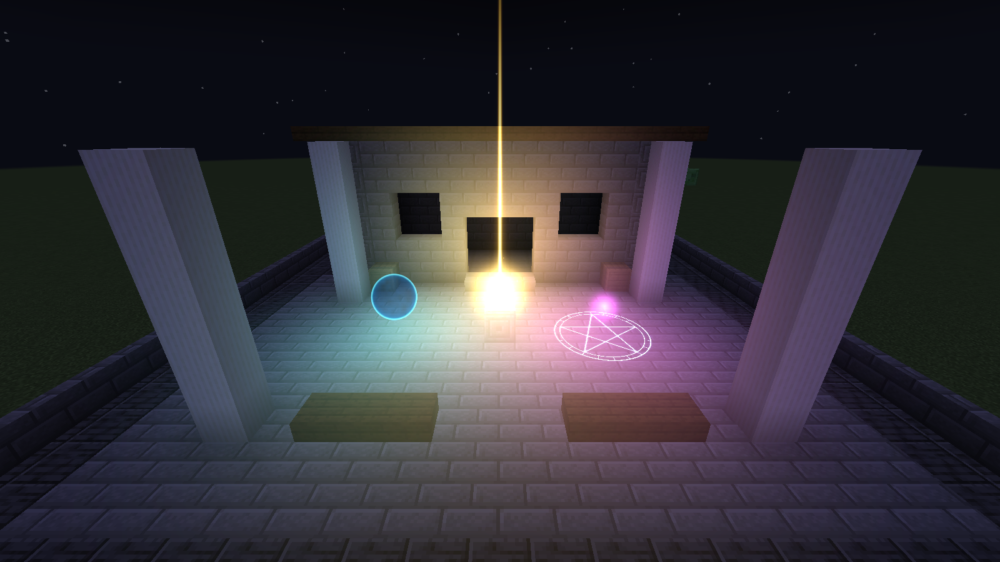
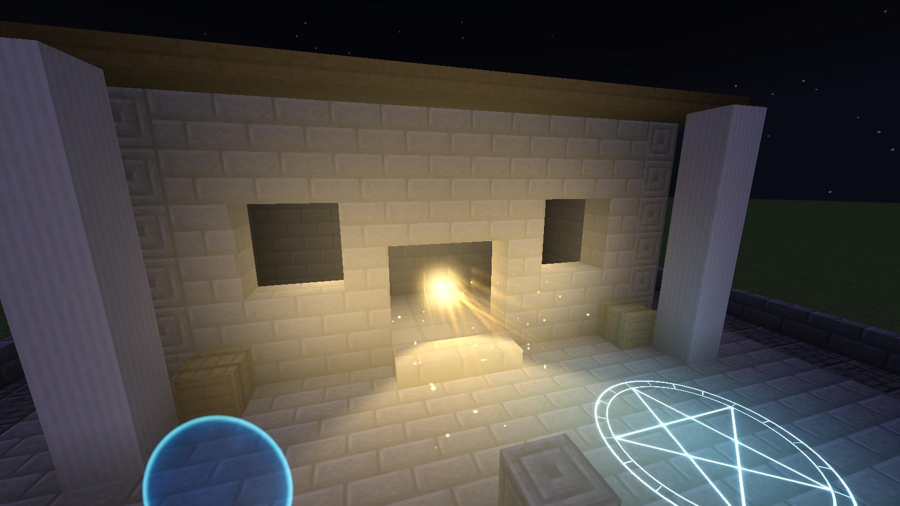
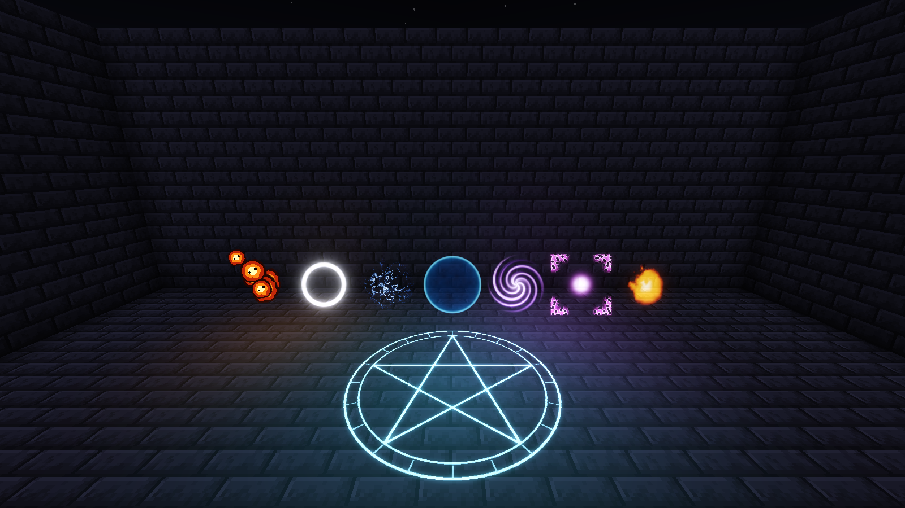
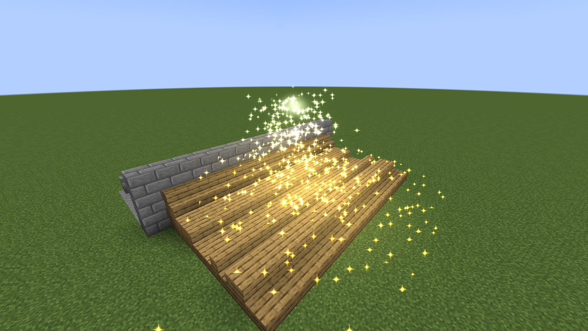
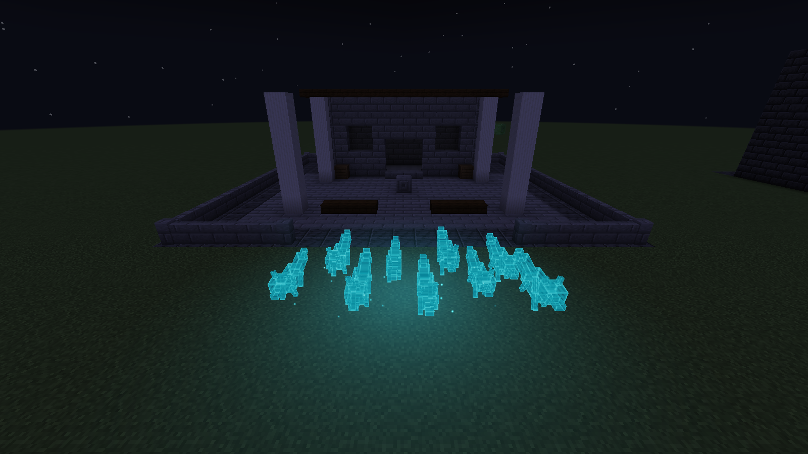
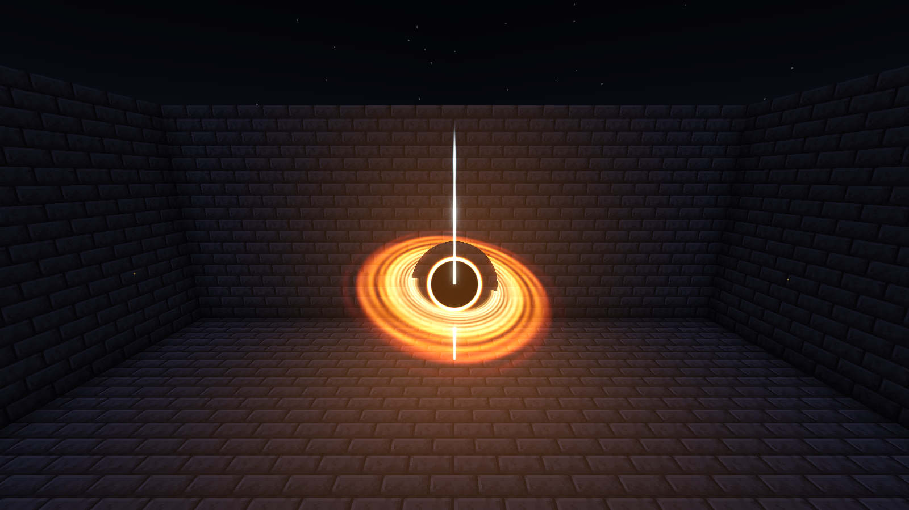
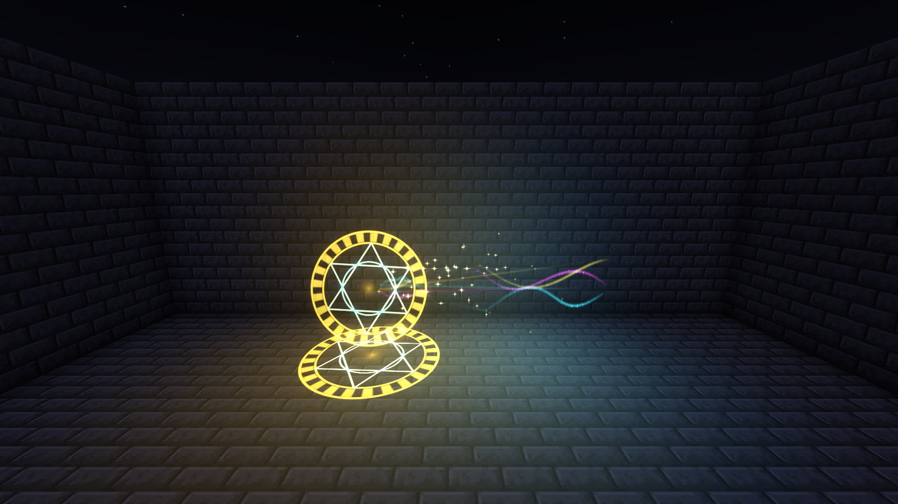
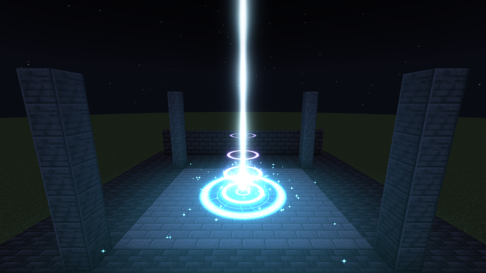
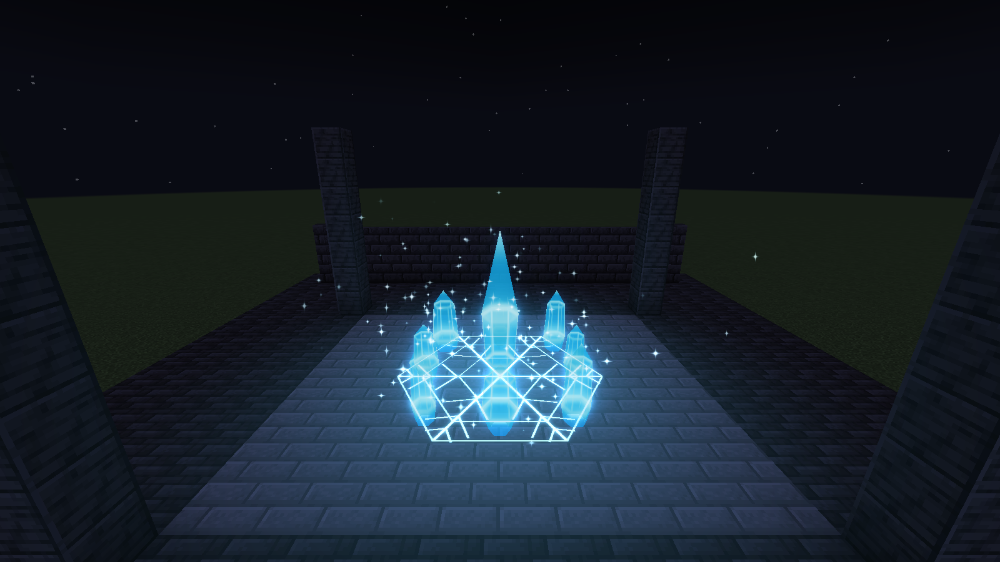
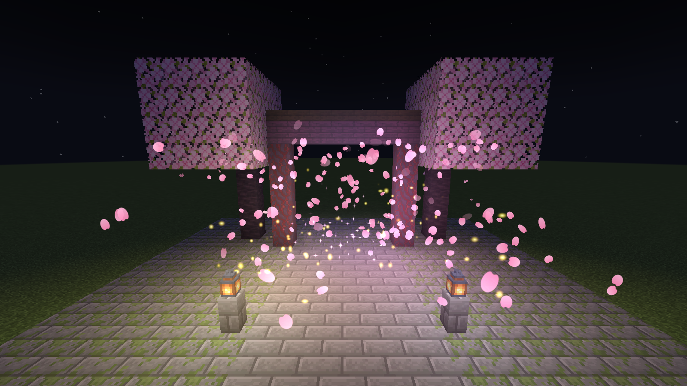

<!-- ====================================================================== -->
<!-- 一句话简介 / About（可直接填入 MC百科 简介栏）                           -->
<!-- ====================================================================== -->
<!--
基于 Photon 26.2 的轻量级跨引擎粒子特效运行库，支持 Unity、Unreal Niagara、Photon 特效、动态光源、体积雾与自定义着色器，26.2/26.3 支持动态 Vulkan/OpenGL 自动切换。
-->

# ✨ LumenFX

**面向 Minecraft 的轻量级、纯资源驱动次世代粒子特效运行库——原生支持 Unity ParticleSystem、Unreal Engine Niagara、Photon `.fx`、动态光源、体积光雾、3D 网格粒子与自定义着色器渲染，内置炫目 HDR 泛光，并在 26.2 / 26.3 自动适配 Vulkan / OpenGL。**

> **分支与衍生说明：** 本模组是 **[Photon](https://github.com/Low-Drag-MC/Photon)**（原作者 **KilaBash** / Low-Drag-MC，Photon 26.2）的独立衍生分支（Fork）。在保留 Photon `.fx` 特效播放与模拟核心的基础上，移除了游戏内编辑器以保持运行库轻量化，并将特效管线扩展至 **Unity / UE Niagara 跨引擎资产** 与 **多版本统一架构**（支持 1.20.1、1.21.1、26.1.2、26.2 与 26.3 的 Forge / NeoForge / Fabric）。

---

## 🌟 实机特效展示

*以下全部 10 组图片均为 LumenFX 原生引擎在游戏内实时渲染截图——**无需安装任何光影模组即可呈现动态光源、体积光雾、HDR 泛光与自定义着色器效果！** 所有特效均已开源收录于仓库 [`examples/showcase-pack`](https://github.com/kltyton/LumenFX/tree/main/examples/showcase-pack) 示例资源包。*

### 💡 动态点光源与聚光灯（Dynamic Lights）
实时彩色点光源与聚光灯照亮方块、石柱与神殿建筑立面，结合青色菲涅尔能量球、金色垂直光柱与紫色五芒星法阵。

### 🌫️ 体积光与体积雾（Volumetric Lights & Fog Volumes）
3D 光线步进体积雾与深度软边缘丁达尔光束穿过神殿门洞洒向广场，伴随浮动的受光尘埃微粒。

### 🎨 全能程序化 VFX 材质（自定义 GLSL 着色器矩阵）
支持自定义 GLSL 片元着色器，呈现三渲二卡通火焰、锐利白光能量环、分支电弧闪电、青色菲涅尔护盾、星界漩涡、蜂窝溶解紫核、扰动火焰与发光五芒星法阵。

### 💥 实时粒子世界碰撞（Particle Collision）
金色星光粒子在重力下倾泻，与真实 Minecraft 楼梯、台阶与石墙碰撞弹跳、逐级滑落并散落在草地上。

### 🦊 3D 全息网格粒子群（3D Mesh / glTF Swarms）
自定义 3D `.lfmesh` 与 glTF 模型作为粒子群组渲染，叠加动态水平全息扫描线、边缘高光与青色地面照明。

### 🕳️ 引力黑洞与相对论吸积盘
深邃事件视界黑核、耀眼爱因斯坦光子环、倾斜旋转吸积盘着色器、双极相对论喷流与环绕星尘。

### 🔮 奥术六芒法阵与三色螺旋丝带拖尾
双层旋转金青奥术法阵，交织释放青、品红、金三色螺旋丝带（Ribbon）流光与星芒微粒。

### ⚡ 轨道等离子天基光束与冲击波
贯通天地的 HDR 青白等离子光柱、上升紫色蓄能环、地面扩散冲击波、延迟贴花焦痕、体积雾与弹跳火星。

### ❄️ 凛冬冰霜新星（3D 晶体 + 低温雾）
破土而出的半透明多面体 3D 冰晶尖刺、发光雪花法阵、低温体积雾与飞舞冰晶雪花。

### 🌸 月夜樱花与金萤圣域
噪声风场驱动飘落的樱花花瓣、HDR 暖金萤火虫、多色柔和局部动态照明与梦幻月夜薄雾。

---

## ⚡ 模组特色

- **单一统一包，26.2 / 26.3 动态 Vulkan 优先 / OpenGL 自动回退**：玩家无需纠结下载“Vulkan 版”还是“OpenGL 版”！在 Minecraft 26.2 与 26.3 中，LumenFX 会在显卡驱动与模组环境支持时**默认启用 Vulkan**，在不支持 Vulkan 或安装了仅支持 OpenGL 的光影模组（如 Iris）时**自动无缝回退至 OpenGL**，并通过无损着色器打包（`compute.lfpack`）大幅精简包体。
- **1.20.1 / 1.21.1 / 26.1.2 原生 OpenGL 全特性对等**：历史版本同样提供内置 HDR 泛光、自定义 GLSL 着色器材质、深度软粒子、完整 Photon `.fx` 时间线/力场/碰撞/子发射器、Niagara GPU 零回读直出绘制（无粒子数量回读上限）、Nanite 簇级 LOD、3D 高斯泼溅、RVT、Groom 毛发、体积雾/贴花/动态光与 3D 空间音频。
- **高吞吐无锁多线程模拟与高效 GPU 上传**：全 10 目标配备无锁工作窃取线程池、LPT 负载排序、主线程重叠调度、预编译 Niagara 参数绑定、指令提升 VectorVM 与多帧环形直写上传。
- **轻量运行库与可选兼容**：Fabric 版需要对应 Minecraft 版本的 Fabric API。LDLib2、Iris、Sodium、GeckoLib（4.x / 5.x）、KBR 和 KilaGraph 均为可选。运行 JAR 不含游戏内编辑器。
- **原生兼容 GeckoLib 与 KBR 粒子关键帧**：全版本支持在 Blockbench 动画 `particle_effects` 关键帧中直接触发 LumenFX 粒子与拖尾，支持 3D 定位点位置与旋转跟随、`pre_effect_script` 参数指令，并与 KBR 原生暴雪/3D 粒子自动分流、和平共存。
- **跨引擎生态与官方 Unity / UE5 编辑器插件**：同时支持 LumenFX JSON、Photon `.fx`、**Unity ParticleSystem（Shuriken）**（仓库提供 **Unity UPM 编辑器插件**，含预设模板、MC 单方块网格参照与批量导出）以及 **Unreal Engine Niagara**（CPU VectorVM、GPU 计算着色器与 SimCache，仓库提供 **UE5 编辑器插件** 与离线编译器）。

---

## 📦 支持版本与加载器

| Minecraft 版本 | 加载器 | 图形后端 |
| :---: | :---: | :--- |
| **26.3** | NeoForge、Fabric | 动态 Vulkan 优先 / OpenGL 自动回退 |
| **26.2** | NeoForge、Fabric | 动态 Vulkan 优先 / OpenGL 自动回退 |
| **26.1.2** | NeoForge、Fabric | 原生 OpenGL（全特性对等管线） |
| **1.21.1** | NeoForge、Fabric | 原生 OpenGL（全特性对等管线） |
| **1.20.1** | Forge、Fabric | 原生 OpenGL（全特性对等管线） |

---

## 🛠️ 模组开发者与创作者资源

- **GitHub 开源仓库（含官方示例特效包、Unity UPM / UE5 编辑器插件与离线编译器）：** [https://github.com/kltyton/LumenFX](https://github.com/kltyton/LumenFX)
- **完整 Wiki 文档、关键帧兼容与 Java API 教程：** [https://github.com/kltyton/LumenFX/wiki](https://github.com/kltyton/LumenFX/wiki)
- **Maven 仓库（Sighs Maven）：** `https://maven.sighs.cc/repository/maven-public/`（坐标 `com.kltyton.lumenfx:lumenfx-<加载器>-<MC版本>:0.3.2`）

---

## 📜 开源协议与致谢

- 本模组为 **KilaBash** / Low-Drag-MC 著作的 **[Photon](https://github.com/Low-Drag-MC/Photon)（Photon 26.2）** 之衍生分支（Fork）。
- 源自 Photon 的运行层代码遵循 **CC BY-NC-SA 4.0** 协议（详见仓库内 `licenses/photon/LICENSE`）；LumenFX 原创代码与离线工具遵循 **MIT** 协议。
- 允许在非商业整合包中自由收录使用。
