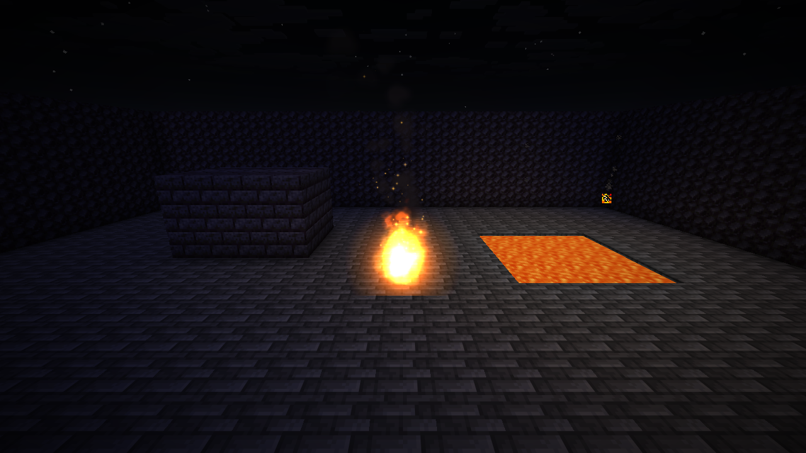

<!-- ====================================================================== -->
<!-- 一句话简介 / About（可直接填入 MC百科 简介栏）                           -->
<!-- ====================================================================== -->
<!--
基于 Photon 26.2 的轻量级跨引擎粒子特效运行库，支持 Unity、Unreal Niagara、Photon 特效与自定义着色器，26.2 支持动态 Vulkan/OpenGL 自动切换。
-->

# ✨ LumenFX

**面向 Minecraft 的轻量级、纯资源驱动次世代粒子特效运行库——原生支持 Unity ParticleSystem、Unreal Engine Niagara 与 Photon `.fx` 特效，内置炫目泛光与自定义着色器渲染，并在 26.2 自动适配 Vulkan / OpenGL。**

> **分支与衍生说明：** 本模组是 **[Photon](https://github.com/Low-Drag-MC/Photon)**（原作者 **KilaBash** / Low-Drag-MC，Photon 26.2）的独立衍生分支（Fork）。在保留 Photon `.fx` 特效播放与模拟核心的基础上，移除了游戏内编辑器以保持运行库轻量化，并将特效管线扩展至 **Unity / UE Niagara 跨引擎资产** 与 **多版本统一架构**（支持 1.20.1、1.21.1、26.1.2、26.2 与 26.3 的 Forge / NeoForge / Fabric）。

---

## 🌟 实机特效展示

*以下图片均为 LumenFX 原生引擎在游戏内实时渲染截图——**无需安装任何光影模组即可呈现泛光与着色器效果！***

### 🔮 符文光环与多色丝带拖尾
支持高精度丝带（Ribbon）拖尾、螺旋轨迹与立体魔法阵，在夜色下勾勒流畅绚丽的能量流光。

*(本地图文件：`docs/publishing/screenshots/01_rune_ribbon_stream.png`)*

### 🌌 星界能量漩涡与传送门氛围
将类 Unity / UE 的多层粒子、径向爆发与柔和辉光融入祭坛、Boss 战与传送门场景，大幅提升画面表现力。

*(本地图文件：`docs/publishing/screenshots/02_astral_vortex_portal.png`)*

### 🔥 内置泛光效果（无需光影模组）
炽烈火球、跃动火星与升腾烟羽开箱即享自然泛光质感，不装光影也能耀眼夺目；安装光影后亦可和谐共存。

*(本地图文件：`docs/publishing/screenshots/03_blazing_ember_fireball.png`)*

### 🎨 自定义着色器材质（渲染过程完全可定制）
支持资源包与模组自带 GLSL 片元着色器，自由打造流光等离子彗尾、能量波纹与各类程序化特效材质。

*(本地图文件：`docs/publishing/screenshots/04_emerald_plasma_comet.png`)*

### 💧 物理模拟与重力粒子喷泉
支持重力抛物线、速度与外力曲线、阻力、旋度噪声及碰撞溅射，由有界多线程引擎高效驱动。

*(本地图文件：`docs/publishing/screenshots/05_luminous_physics_fountain.png`)*

---

## ⚡ 模组特色

- **单一统一包，26.2 / 26.3 动态 Vulkan 优先 / OpenGL 自动回退**：玩家无需纠结下载“Vulkan 版”还是“OpenGL 版”！在 Minecraft 26.2 与 26.3 中，LumenFX 会在显卡驱动与模组环境支持时**默认启用 Vulkan**，在不支持 Vulkan 或安装了仅支持 OpenGL 的光影模组（如 Iris）时**自动无缝回退至 OpenGL**，并通过无损着色器打包（`compute.lfpack`）大幅精简包体。
- **1.20.1 / 1.21.1 / 26.1.2 原生 OpenGL 全特性对等**：历史版本同样提供内置 HDR 泛光、自定义 GLSL 着色器材质、深度软粒子、完整 Photon `.fx` 时间线/力场/碰撞/子发射器、Niagara GPU 零回读直出绘制（无粒子数量回读上限）、Nanite 簇级 LOD、3D 高斯泼溅、RVT、Groom 毛发、体积雾/贴花/动态光与 3D 空间音频。
- **高吞吐无锁多线程模拟与高效 GPU 上传**：全 10 目标配备无锁工作窃取线程池、LPT 负载排序、主线程重叠调度、预编译 Niagara 参数绑定、指令提升 VectorVM 与多帧环形直写上传。
- **极致轻量、零强制外部前置**：完全独立运行，不再强制依赖 `LDLib2`、`KilaGraph` 或任何渲染/光影模组；运行 JAR 剔除游戏内编辑器与冗余资源，与 **Iris、Sodium、GeckoLib（4.x / 5.x）、KBR、KilaGraph** 共装时自动启用纯可选软兼容。
- **原生兼容 GeckoLib 与 KBR 粒子关键帧**：全版本支持在 Blockbench 动画 `particle_effects` 关键帧中直接触发 LumenFX 粒子与拖尾，支持 3D 定位点位置与旋转跟随、`pre_effect_script` 参数指令，并与 KBR 原生暴雪/3D 粒子自动分流、和平共存。
- **跨引擎生态与官方 Unity / UE5 编辑器插件**：同时支持 LumenFX JSON、Photon `.fx`、**Unity ParticleSystem（Shuriken）**（仓库提供 **Unity UPM 编辑器插件**，含预设模板、MC 单方块网格参照与批量导出）以及 **Unreal Engine Niagara**（CPU VectorVM、GPU 计算着色器与 SimCache，仓库提供 **UE5 编辑器插件** 与离线编译器）。

---

## 📦 支持版本与加载器

| Minecraft 版本 | 加载器 | 图形后端 |
| :---: | :---: | :--- |
| **26.3** | NeoForge、Fabric | 动态 Vulkan 优先 / OpenGL 自动回退 |
| **26.2** | NeoForge、Fabric | 动态 Vulkan 优先 / OpenGL 自动回退 |
| **26.1.2** | NeoForge、Fabric | 原生 OpenGL（全特性对等管线） |
| **1.21.1** | NeoForge、Fabric | 原生 OpenGL（全特性对等管线） |
| **1.20.1** | Forge、Fabric | 原生 OpenGL（全特性对等管线） |

---

## 🛠️ 模组开发者与创作者资源

- **GitHub 开源仓库（含 Unity UPM / UE5 编辑器插件与离线编译器）：** [https://github.com/kltyton/LumenFX](https://github.com/kltyton/LumenFX)
- **完整 Wiki 文档、关键帧兼容与 Java API 教程：** [https://github.com/kltyton/LumenFX/wiki](https://github.com/kltyton/LumenFX/wiki)
- **Maven 仓库（Sighs Maven）：** `https://maven.sighs.cc/repository/maven-public/`（坐标 `com.kltyton.lumenfx:lumenfx-<加载器>-<MC版本>:0.3.0`）

---

## 📜 开源协议与致谢

- 本模组为 **KilaBash** / Low-Drag-MC 著作的 **[Photon](https://github.com/Low-Drag-MC/Photon)（Photon 26.2）** 之衍生分支（Fork）。
- 源自 Photon 的运行层代码遵循 **CC BY-NC-SA 4.0** 协议（详见仓库内 `licenses/photon/LICENSE`）；LumenFX 原创代码与离线工具遵循 **MIT** 协议。
- 允许在非商业整合包中自由收录使用。
