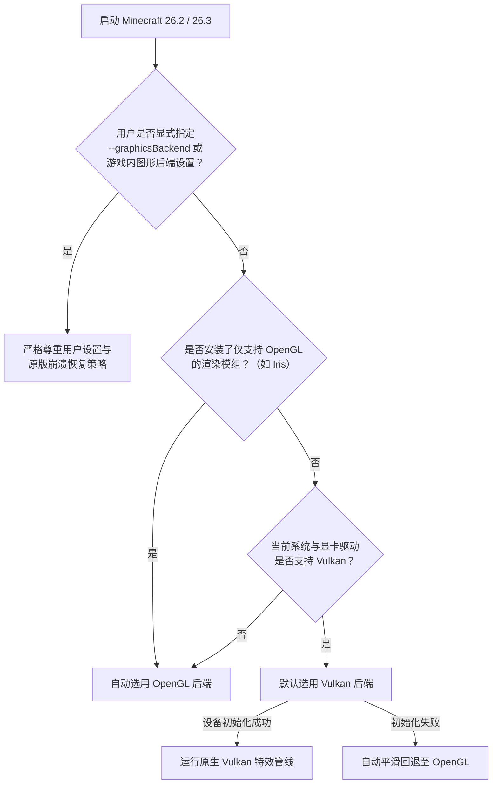

  <a href="Graphics-Backends-and-Compatibility">English</a> | <strong>简体中文</strong>

# 图形后端与模组兼容说明

## 单一统一 JAR 交付

LumenFX 对每个 Minecraft 版本与加载器仅发布**单一统一 JAR**。玩家与整合包作者无需区分“Vulkan 专用版”或“OpenGL 专用版”。

---

## 动态图形后端自动判定（Minecraft 26.2 & 26.3）

在 **Minecraft 26.2 与 26.3**（NeoForge 与 Fabric）启动时，LumenFX 会动态检测运行环境并自动选择最佳图形后端：

### 核心行为保证

1. **支持时默认启用 Vulkan**：纯独立运行 Minecraft 26.2/26.3 或与支持 Vulkan 的渲染优化模组（如 **Sodium**）共装时，默认自动运行原生 Vulkan 特效管线。
2. **不可用时自动无缝回退 OpenGL**：若系统无可用 Vulkan 驱动、Vulkan 设备创建失败，或检测到仅支持 OpenGL 的光影模组（如 **Iris**），LumenFX 会自动切换至 OpenGL 特效管线，无需修改配置或更换模组文件。
3. **始终尊重用户显式偏好**：启动参数 `--graphicsBackend`、游戏内视频后端设置及原版启动崩溃恢复始终具有最高优先级。

---

## 原生 OpenGL 全特性目标（1.20.1、1.21.1、26.1.2）

Minecraft **1.20.1（Forge / Fabric）**、**1.21.1（NeoForge / Fabric）** 与 **26.1.2（NeoForge / Fabric）** 原生运行于 OpenGL 3.3+ / 4.3+ 并提供全特性对等管线：内置 RGBA16F HDR 泛光、自定义 GLSL 330 Core 材质着色器、场景深度软粒子、完整 Photon `.fx` 时间线/力场/碰撞/子发射器、Niagara GPU 零回读 SSBO 直出绘制与 GPU Bitonic 排序、Nanite 簇级 LOD、3D 高斯泼溅、RVT、Groom 毛发、体积雾/贴花/动态光、3D OpenAL 空间音频以及无锁工作窃取多线程模拟。

---

## 可选模组兼容

Fabric 版需要对应 Minecraft 版本的 Fabric API。LDLib2、KilaGraph、渲染优化、光影和动画模组均为可选。

| 模组 | 依赖类型 | 共装表现 |
| :--- | :---: | :--- |
| **Iris** | 可选（Optional） | 26.2 与 26.3 下自动选择 OpenGL 后端，并将场景颜色、深度与曝光与活动光影包正确合成。 |
| **Sodium** | 可选（Optional） | 同时兼容 26.2 / 26.3 Vulkan 与 OpenGL 管线，完整保留区块深度与透明粒子合成。 |
| **GeckoLib（4.x / 5.x）** | 可选（Optional） | 保留原生回调接口语义（不做自动生成粒子）；回调中调用 `LumenFxKeyframeBridge.trigger(...)` 时自动启用 3D 定位点/骨骼姿态跟随与重置清理（详见 [[动画粒子关键帧集成\|GeckoLib-and-KBR-Keyframes-zh]]）。 |
| **KBR / KBR-Lite（KltytonBedrockRuntime）** | 可选（Optional） | 共享渲染兼容，并在 KBR 自动关键帧入口自动分流 LumenFX 与 KBR 暴雪/3D 粒子（避免 KBR 对非 KBR ID 报错，且不受 Mixin 顺序影响），并支持完整版 KBR 原生基岩动画回落。 |
| **PAL / PALMore（PlayerAnimationLibrary / MoreRotation）** | 可选（Optional） | 保留原生回调接口语义（不做自动生成粒子）；回调中调用 `LumenFxKeyframeBridge.trigger(...)` 时自动逐帧追踪玩家骨骼（含原生及 PALMore 3 轴 bend 变形）与动画停止清理。 |
| **合拍（AnimCue，`interactive_animation` 0.1.2+）** | 可选（Optional） | 遵循原版粒子 → KBR → LumenFX 优先级自动播放本地与联机服务端同步场景中的 LumenFX 关键帧，支持多参与者同名定位点隔离、骨骼/bend 3D 跟随与场景结束自动清理。 |
| **KilaGraph** | 可选（NeoForge 26.2） | 当环境中同时安装了 `kilagraph` 与 `ldlib2` 时，自动通过软兼容桥接启用 Photon `.fx` 着色器图材质；未安装时完全零依赖。 |

所有可选依赖均使用开放兼容版本范围声明，不锁死单一发行版本。
