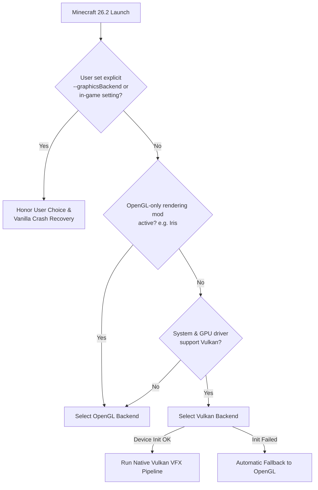

  <strong>English</strong> | <a href="Graphics-Backends-and-Compatibility-zh">简体中文</a>

# Graphics Backends & Compatibility

## Single Unified JAR Per Target

LumenFX delivers **one unified JAR** per Minecraft version and mod loader. Players never need to choose between separate "Vulkan" and "OpenGL" mod files.

---

## Dynamic Backend Selection (Minecraft 26.2)

On **Minecraft 26.2** (NeoForge & Fabric), LumenFX dynamically inspects the runtime environment at startup and selects the optimal graphics backend:

### Key Guarantees

1. **Vulkan by Default When Available**: Standalone Minecraft 26.2 and Vulkan-compatible co-installs (such as **Sodium**) run directly on the native Vulkan VFX pipeline.
2. **Automatic OpenGL Fallback**: If the system lacks a working Vulkan driver, if Vulkan device creation fails, or if an OpenGL-only shader mod (such as **Iris**) is installed, LumenFX seamlessly routes to its OpenGL VFX pipeline without crashing or requiring manual config edits.
3. **Explicit User Control Always Wins**: Command-line flags (`--graphicsBackend`), Minecraft's video backend setting, and vanilla crash-recovery logic are always respected.

---

## Legacy Targets (1.20.1, 1.21.1, 26.1.2)

Minecraft **1.20.1 (Forge / Fabric)**, **1.21.1 (NeoForge / Fabric)**, and **26.1.2 (NeoForge / Fabric)** use OpenGL natively. All six legacy targets ship the full LumenFX runtime (Unity ParticleSystem, Unreal Niagara CPU + GPU compute + SimCache handoff, and Photon `.fx`) on the direct OpenGL pipeline.

---

## Optional Mod Compatibility

LumenFX is completely **standalone** — it has zero required external mod dependencies (no mandatory `LDLib2`, `KilaGraph`, rendering mod, or animation mod).

| Mod | Dependency Type | Behavior When Installed |
| :--- | :---: | :--- |
| **Iris** | Optional | On 26.2, automatically selects OpenGL and integrates scene color, depth, and exposure with active shader packs. |
| **Sodium** | Optional | Compatible on both Vulkan (26.2) and OpenGL paths with full chunk-depth & scene compositing. |
| **GeckoLib (4.x / 5.x)** | Optional | Enables Blockbench `particle_effects` keyframe routing to LumenFX with 3D locator/bone position & rotation tracking across all 8 targets (see [[GeckoLib & KBR Keyframes\|GeckoLib-and-KBR-Keyframes]]). |
| **KBR (KltytonBedrockRuntime)** | Optional | Full rendering co-install compatibility plus seamless keyframe coexistence (unmatched IDs pass through to KBR Bedrock/SnowStorm particles, and KBR native animation fallbacks route to LumenFX). |
| **KilaGraph** | Optional (NeoForge 26.2) | When both `kilagraph` and `ldlib2` are installed alongside LumenFX, Photon `.fx` shader-graph materials automatically activate via reflective soft-compat bridge. |

All optional dependencies are declared with open compatible version ranges (never pinned to a single exact release).
