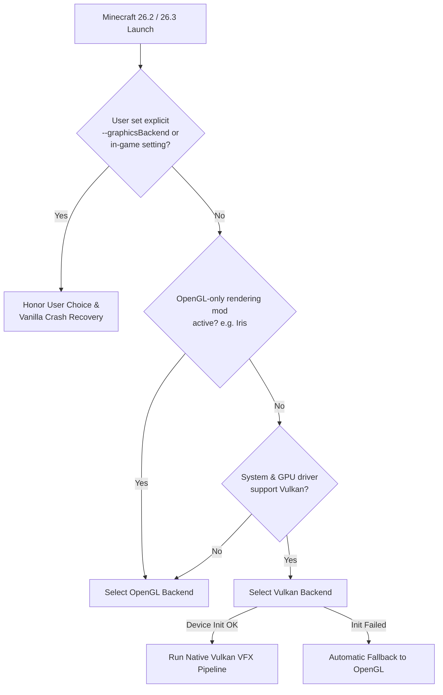

  <strong>English</strong> | <a href="Graphics-Backends-and-Compatibility-zh">简体中文</a>

# Graphics Backends & Compatibility

## Single Unified JAR Per Target

LumenFX delivers **one unified JAR** per Minecraft version and mod loader. Players never need to choose between separate "Vulkan" and "OpenGL" mod files.

---

## Dynamic Backend Selection (Minecraft 26.2 & 26.3)

On **Minecraft 26.2 & 26.3** (NeoForge & Fabric), LumenFX dynamically inspects the runtime environment at startup and selects the optimal graphics backend:

### Key Guarantees

1. **Vulkan by Default When Available**: Standalone Minecraft 26.2/26.3 and Vulkan-compatible co-installs (such as **Sodium**) run directly on the native Vulkan VFX pipeline.
2. **Automatic OpenGL Fallback**: If the system lacks a working Vulkan driver, if Vulkan device creation fails, or if an OpenGL-only shader mod (such as **Iris**) is installed, LumenFX seamlessly routes to its OpenGL VFX pipeline without crashing or requiring manual config edits.
3. **Explicit User Control Always Wins**: Command-line flags (`--graphicsBackend`), Minecraft's video backend setting, and vanilla crash-recovery logic are always respected.

---

## Native OpenGL Targets (1.20.1, 1.21.1, 26.1.2)

Minecraft **1.20.1 (Forge / Fabric)**, **1.21.1 (NeoForge / Fabric)**, and **26.1.2 (NeoForge / Fabric)** run natively on OpenGL 3.3+ / 4.3+ with full feature parity: built-in RGBA16F HDR Bloom, custom GLSL 330 Core material shaders, scene depth soft particles, complete Photon `.fx` timelines/forcefields/collisions/sub-emitters, zero-readback GPU Niagara SSBO direct draw & GPU bitonic sorting, Nanite cluster LOD meshes, 3D Gaussian Splatting, RVT, Groom hair strands, volumetric fog/decals/lights, 3D OpenAL spatial audio, and lock-free work-stealing multi-threaded simulation.

---

## Optional Mod Compatibility

Fabric builds require Fabric API for the matching Minecraft version. LDLib2, KilaGraph, rendering mods, and animation mods are optional.

| Mod | Dependency Type | Behavior When Installed |
| :--- | :---: | :--- |
| **Iris** | Optional | On 26.2 & 26.3, automatically selects OpenGL and integrates scene color, depth, and exposure with active shader packs. |
| **Sodium** | Optional | Compatible on both Vulkan (26.2 / 26.3) and OpenGL paths with full chunk-depth & scene compositing. |
| **GeckoLib (4.x / 5.x)** | Optional | Preserves native callback-only semantics (no unsolicited auto-spawning); calling `LumenFxKeyframeBridge.trigger(...)` inside a callback automatically enables 3D locator/bone tracking and reset cleanup (see [[Animation Particle Keyframes\|GeckoLib-and-KBR-Keyframes]]). |
| **KBR / KBR-Lite (KltytonBedrockRuntime)** | Optional | Full rendering co-install compatibility plus seamless keyframe coexistence at KBR's dispatchers (prevents KBR unknown-ID errors independent of Mixin apply order), and routes full KBR native animation fallbacks to LumenFX. |
| **PAL / PALMore** | Optional | Preserves native callback-only semantics (no unsolicited auto-spawning); calling `LumenFxKeyframeBridge.trigger(...)` inside a PAL/PALMore callback automatically tracks animated player bones (including native X-bend and PALMore 3-axis bend/position/scale) and cleans up on controller reset/stop. |
| **AnimCue (`interactive_animation` 0.1.2+)** | Optional | Follows Vanilla → KBR → LumenFX priority to auto-play LumenFX keyframes in both local client and server-synced multiplayer scenes, with per-participant locator isolation, 3D bone/bend tracking, and automatic cleanup on scene finish. |
| **KilaGraph** | Optional (NeoForge 26.2) | When both `kilagraph` and `ldlib2` are installed alongside LumenFX, Photon `.fx` shader-graph materials automatically activate via reflective soft-compat bridge. |

All optional dependencies are declared with open compatible version ranges (never pinned to a single exact release).
