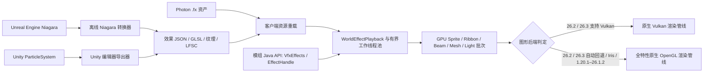

  <a href="Home">English</a> | <strong>简体中文</strong>

# 欢迎来到 LumenFX Wiki

**LumenFX** 是一款面向 Minecraft 的轻量级、纯资源驱动跨引擎粒子特效运行库，同时支持 **LumenFX JSON**、**Unity ParticleSystem（Shuriken）** 导出资源、**Unreal Engine Niagara**（CPU VectorVM、GPU SPIR-V 计算着色器与 SimCache `.lfsc`）以及 **Photon `.fx`** 资产，覆盖 **Minecraft 1.20.1、1.21.1、26.1.2、26.2 与 26.3**（Forge、NeoForge、Fabric）。

> **分支关系说明：** LumenFX 是 **[Photon](https://github.com/Low-Drag-MC/Photon)**（原作者 KilaBash / Low-Drag-MC，Photon 26.2）的独立衍生分支（Fork）。它保留了 Photon 的 `.fx` 粒子核心与模拟能力，从运行 JAR 中移除游戏内编辑器以保持轻量，并扩展了跨引擎离线资产管线、Minecraft 26.2 / 26.3 动态 Vulkan / OpenGL 自动渲染与 1.20.1–26.1.2 全特性原生 OpenGL 对等管线。

---

## 架构总览

---

## 文档目录

| 页面 | 内容概要 |
| :--- | :--- |
| **[[快速入门与 API\|Getting-Started-zh]]** | 玩家安装步骤、10 目标支持矩阵、Sighs Maven 依赖配置与 Java API 快速上手（`VfxEffects` / `EffectHandle`）。 |
| **[官方示例特效资源包](https://github.com/kltyton/LumenFX/tree/main/examples/showcase-pack)** | 可直接加载的示例资源包，收录全部 10 组实机展示特效（动态光源、体积雾、程序化 GLSL 材质、方块碰撞、3D 全息网格、黑洞、丝带、等离子光束、冰霜新星与樱花圣域）。 |
| **[[效果格式与着色器参考\|Effect-Format-Reference-zh]]** | 资源目录约定、LumenFX JSON v1 字段表、曲线与随机范围、发射形状、渲染器与自定义 GLSL 片元着色器。 |
| **[[Niagara、Unity 与 Photon 工作流\|Niagara-and-Unity-Workflow-zh]]** | Unity UPM 编辑器插件、Unreal Engine 5 编辑器插件与 Niagara 离线编译器流程，以及 Photon `.fx` 兼容说明。 |
| **[[GeckoLib 与 KBR 粒子关键帧\|GeckoLib-and-KBR-Keyframes-zh]]** | 在 GeckoLib 4.x / 5.x 与 KBR 的 Blockbench `particle_effects` 关键帧中触发 LumenFX 特效、3D 定位点跟随与 `LumenFxKeyframeBridge` API。 |
| **[[图形后端与模组兼容\|Graphics-Backends-and-Compatibility-zh]]** | Minecraft 26.2 动态 Vulkan 优先 / OpenGL 自动回退逻辑、用户显式参数覆盖，以及 Iris / Sodium / GeckoLib / KBR / KilaGraph 可选兼容说明。 |
| **[[分支渊源与开源许可\|Fork-and-Licensing-zh]]** | 与上游 Photon 26.2 的分支关系、核心差异对比、署名要求与 MIT / CC BY-NC-SA 4.0 许可明细。 |
