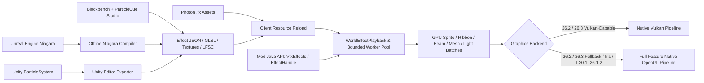

  <strong>English</strong> | <a href="Home-zh">简体中文</a>

# Welcome to the LumenFX Wiki

**LumenFX** is a lightweight, resource-driven cross-engine VFX runtime for Minecraft supporting **LumenFX JSON**, **Unity ParticleSystem (Shuriken)** exports, **Unreal Engine Niagara** (CPU VectorVM, GPU compute SPIR-V, and SimCache `.lfsc`), and **Photon `.fx`** assets across **Minecraft 1.20.1, 1.21.1, 26.1.2, 26.2, and 26.3** (Forge, NeoForge, and Fabric).

> **Fork Relationship:** LumenFX is a fork of **[Photon](https://github.com/Low-Drag-MC/Photon)** (Photon 26.2 by KilaBash / Low-Drag-MC). It preserves Photon's `.fx` particle core while removing the in-game editor from the runtime JAR and extending the engine with cross-engine authoring pipelines, dynamic Vulkan / OpenGL rendering on 26.2 & 26.3, and full-feature native OpenGL parity on 1.20.1–26.1.2.

---

## Architecture Overview

---

## Documentation Index

| Page | Topics Covered |
| :--- | :--- |
| **[[Getting Started\|Getting-Started]]** | Mod installation, supported 10-target matrix, Sighs Maven coordinates, and Java API quickstart (`VfxEffects` & `EffectHandle`). |
| **[[Example Effects & Showcase Pack\|Examples]]** | Complete developer guide to the 15 standalone example effects (`classic/*`, `photon/*`, `bonus/*`), custom GLSL shaders, `.lfmesh` models, and Java/keyframe usage in [`examples/showcase-pack`](https://github.com/kltyton/LumenFX/tree/main/examples/showcase-pack) (never bundled into runtime JARs). |
| **[[Effect Format Reference\|Effect-Format-Reference]]** | Resource layout, LumenFX JSON v1 schema, curves/ranges, shapes, emitters, renderers, and custom GLSL fragment shaders. |
| **[[Niagara, Unity & Photon Workflow\|Niagara-and-Unity-Workflow]]** | Using the Unity UPM Editor Plugin, Unreal Engine 5 Editor Plugin & Niagara CLI compiler, playing Photon `.fx` files, and authoring LumenFX JSON / `.fsh` shaders in Blockbench with **[ParticleCue Studio](https://github.com/kltyton/ParticleCue-Studio)**. |
| **[[GeckoLib & KBR Particle Keyframes\|GeckoLib-and-KBR-Keyframes]]** | Triggering LumenFX effects from Blockbench `particle_effects` keyframes on GeckoLib 4.x / 5.x & KBR with 3D locator tracking and `LumenFxKeyframeBridge`. |
| **[[Graphics Backends & Compatibility\|Graphics-Backends-and-Compatibility]]** | Minecraft 26.2 dynamic Vulkan-first / OpenGL fallback rules, user overrides, and optional Iris / Sodium / GeckoLib / KBR / KilaGraph compatibility. |
| **[[Fork Lineage & Licensing\|Fork-and-Licensing]]** | Relationship to upstream Photon 26.2, attribution requirements, MIT & CC BY-NC-SA 4.0 licensing breakdown. |
| **[[AI Agent Skill (Experimental)\|AI-Agent-Skill]]** | Experimental AI Agent Skill ([`skills/lumenfx-vfx`](https://github.com/kltyton/LumenFX/tree/main/skills/lumenfx-vfx)) with strict JSON v1 / GLSL 330 references and a zero-dependency validator script for Codex, Antigravity, Claude Code, and Cursor. |
