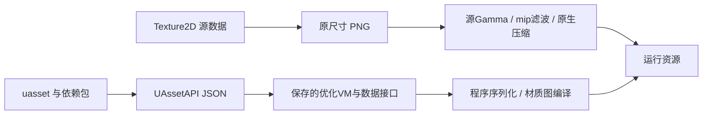

# Niagara离线转换

输入为 UAssetAPI 导出的真实包描述、原 Texture2D 解码 PNG 及匹配版本的 UE 源码。转换器输出 LumenFX JSON、GLSL、原 PNG、纹理旁车和向量场。固定 UE 纹理工具随后按原项目和目标平台生成编码 mip。转换器依赖 .NET 10 和 Newtonsoft.Json，工具及源引擎不进入模组 JAR。



## 命令

```powershell
dotnet build tools/compiler/LumenFx.Compiler.csproj -o <compiler-output>
dotnet <compiler-output>/LumenFx.Compiler.dll niagara <json-root> /Game/effects/trail.trail my_mod:effects/trail <png-root> <resources-root> <texture-aliases.json> <render-profile.json> <vector-field-json-root> <unreal-source-root> [engine-function-json-root] [engine-texture-json-root]
dotnet <compiler-output>/LumenFx.Compiler.dll graph <json-root> /Niagara/Modules/Update/Forces/V2/CurlNoiseForce.CurlNoiseForce <output.json> [engine-function-json-root]
./gradlew.bat bakeEffectTextures -PtextureDirectory=<effect-texture-directory> -PtextureNativeExecutable=<LumenFxTextureBuild.exe> -PtextureSourceProject=<source.uproject> -PtextureTargetPlatform=<UE-target-platform> -PtextureContentMounts=<mounts.json> -PtextureWorkDirectory=<work-directory> -PtextureCacheDirectory=<cache-directory> [-PtextureNativeEncodeSpeed=<source-encode-speed>]
```

`resources-root`通常为使用方项目的`src/main/resources`。写入前解析所需的包、图和 PNG。PNG 优先按包目录与对象名查找，`/Game/` 可使用省略 Game 的相对布局。旧平铺导出在文件名唯一时可继续使用。同名包通过独立输出 ID 保留各自绑定。PNG 的宽高必须与原 Texture2D 声明一致，转换器逐字节复制原 PNG。

按完整包路径保存JSON：`<json-root>/Game/effects/trail.json`。也可提供`asset-index.json`，以完整`/Game/...`为键、相对JSON路径为值。包头的FolderName不是文件所在路径，不能用于解决同名函数。旧UE4包的LegacyFileVersion大于-8，不带UE5版本字段；有完整版本信息时使用UAssetAPI的UNKNOWN入口读取实际包头，不能强制套用UE5.8的头结构。

引用`/Engine/Functions/...`时，可通过末尾的`engine-function-json-root`提供匹配引擎的函数描述；其目录结构为`Engine/Functions/.../*.json`。所有输入根先按完整包路径和索引解析，再处理原有项目平面布局。CustomRotator与BreakOutFloat函数均经同一图解析器读取实际引脚、类型、默认值及运算，不使用手写数学替代分支。这些描述仅作为离线输入，不进入运行包，也不接入正常构建。

`tools/unreal/Export-UnrealAssets.ps1`可从指定Content目录递归导出选定包的材质、函数和纹理描述，并生成上述完整包索引。参数为`-SourceContent`、`-JsonRoot`、`-Packages /Game/effects/trail`、`-UAssetExportDll`和已登记的`-TemporaryDirectory`；只读取源包。`-Dotnet`可指定本机.NET入口，未版本化包通过`-UnversionedEngine`指定实际引擎格式。PNG仍由支持源压缩的解码器按对应包独立导出。

UAssetAPI描述需包含Niagara变量名/偏移/类型及VarData、材质原生Expression/OutputIndex/Mask、UseConstantValue、LinearColor和float32材质向量。UE5.8还需读取FText和GatherableText的DevNotes。旧属性标签中的`VariableToScriptVariable`须指定NiagaraVariable→Object，`PinOutputToPinDefaultPersistentId`须指定Guid→Guid。Texture2D的UEDELTA源压缩须由支持该格式的离线工具解码，不能采用缩略图。

如果导出 `MI_3DGas_Base` 等旧包时，结构数组读到对象末尾并将原始对象标成 `RawExport`，请检查导出器是否读取了旧式内部属性标签的扩展字段。当前 NiagaraFluids 插件仍随附处于 `PROPERTY_TAG_EXTENSION_AND_OVERRIDABLE_SERIALIZATION` 版本的原包。使用[结构数组补丁](../unreal/uassetapi/patches/legacy-struct-array-property-tags.patch)修补现有 UAssetAPI 源副本。从含 `UAssetAPI/` 的源码根目录用 `git apply --check <patch>` 核实兼容性，再用 `git apply <patch>` 应用补丁。重新构建现有 UAssetExport，把产物传给 `-UAssetExportDll`。补丁复用常规标签的 GUID 和扩展字段读写，并按实际载荷偏移回填长度。

没有保存父层关联状态的旧材质实例需要按 FText 比较层名。使用与当前对照源码和编辑器版本一致的 `tools/unreal/text_resolve` Program 及其 ICU 数据，并将 `--text-native-tools <绝对可执行文件> <绝对工作目录>` 加在 Niagara 转换参数末尾。`--text-language` 选择翻译语言，`--text-locale` 选择格式化区域，`--text-locres <绝对文件>` 可重复指定由高到低优先级的翻译资源，`--text-content-root </Root/> <绝对Content目录>` 挂载字符串表包。JSON 输入需保留各个 FText 的历史字段。项目自定义文本生成器须在对应的原生环境中注册。

Sound Cue 的 Dialogue Player 也使用该工具。原 `DialogueWave` 按说话者和有序听者引用解析录音及当前导出语言的字幕。录音走既有 `--audio-native-tools` 的 LFAW 导出。Minecraft 根据用户的字幕设置显示保存的对白字幕。

## 模块与材质

Substrate Toon 材质使用单独导出的原生配置切片。在同版 UE 项目和启用 Substrate 的图形 RHI 下运行 `LumenFxTextureBuild` 的 `-toon-profiles=<绝对请求文件>` 模式。请求的 `profiles` 数组中每项包含 `asset` 和绝对 `output`。默认配置的 `asset` 为 `None`，其余使用 `UToonProfile` 的完整对象路径。把同一原生分辨率的 `.lftp` 放入资源命名空间的 `lumenfx/toon_profiles/`。每个配置只需一份资源，Sprite、Ribbon 和 Mesh 按实际材质绑定共享。点光所用的 GGX Max 表复用原 `-shading-energy` 输出或源运行时表生成。

CPU系统读取保存的`ExperimentalContextData`、常量重映射、输入/输出布局及实际ResolvedDataInterface，保留系统Spawn/Update与各发射器Spawn/Update的优化指令顺序。曲线数据接口按源`bUseLUT`读取保存的查找表或曲线；发射、随机、场力、阻力、颜色与尺寸由程序执行，不从模块名称重建简化内核。

材质编译处理算术、点积、插值、遮罩、UV、时间、粒子颜色、动态参数、常量/参数、纹理采样、函数输入/输出、静态分支、旋转、三角函数及限定的Custom HLSL。材质实例按最近覆盖保留BlendMode、TwoSided及OpacityMaskClipValue；透明拖带与加法火花分别使用源混合模式。共同表达式与纹理采样编译为main内的局部值，避免重复展开整棵表达式。纹理函数、参数覆盖和通道掩码保留；fmod和反向smoothstep按HLSL代数实现，不借用GLSL对反向边界未定义的行为。

转换显式保存ApplyFogging、逐像素雾开关与TranslucencyPass，默认值来自源材质。生成材质与内置材质共用运行库的雾出口；散射/透射由当前场景提供，材质本身不携带NewMap全局雾场。AfterMotionBlur材质禁用源深度测试；未使用DOF或运动模糊的宿主按阶段顺序合成。AlphaHoldout使用独立的遮除混合，不作为普通透明材质处理。

平面Ribbon不补发射器头点，保留源渲染器的双面默认值、CurveTension和自适应细分配置；UV0/UV1分别保存分布、比例和偏移。Sprite保留源旋转、像素覆盖补偿、显式视距/视深排序及SortOrderHint。材质保留深度测试标记、纹理寻址和硬件sRGB采样；Power采用UE5.8的PositiveClampedPow阈值。源CPU发射器采用默认一百万粒子的容量上界，按实际出生数量分配。

可选 `render-profile.json` 写入效果根节点的 `render`，用于提供粒子材质所需的参考雾参数；`fog.enabled`、`fog.per_pixel`、混合模式及透明阶段由各材质从实际源资产导入。世界曝光与后处理由宿主管线负责。

## 向量场与保存的更新程序

`tools/unreal/fetch_dependency.py`按固定引擎清单的File→Blob→Pack关系提取选定依赖，只下载对应压缩包并核对清单摘要，不安装整套引擎。`VectorFieldAsset`生产LFVF2，保留原始RGBA半浮点、UE轴及厘米边界；运行时场采样保持源坐标，最终渲染再换算Minecraft坐标。既有LFVF1读取路径保留。

`VectorProgramCompiler`按匹配源码的opcode声明解码保存的优化程序。运行时按四lane批次执行，保留XORWOW浮点转换和源固定种子哈希的不同语义；Windows数学指令使用对应MSVC向量函数。`graph`命令仍可导出原图和引脚，供资料定位使用。

GPU 仿真、未实现的 VM 指令／数据接口及材质节点给出明确来源错误，不输出缺层效果。Unity 使用独立的 Editor 导出入口。

## 纹理资源

`.lftex.json` 记录原 PNG 摘要、颜色空间、mip 滤波和采样属性。对带 `build_backend: unreal_native` 的旁车使用上面的原生入口。通过 `tools/unreal/texture_build/Build-TextureBuild.ps1` 从与目标项目匹配的 UE5 源码构建工具，传入 `-UnrealSourceRoot` 和 `-WorkDirectory`。挂载 JSON 将 `/Game/` 指到项目 Content，将 `/Engine/...` 指到对应引擎内容目录。Windows 编辑器目标名称为 `WindowsEditor`。

原生入口从实际包读取平台 mip，使用显式工作目录和缓存目录，校验输出后发布同名 `.lftx`。当前运行平台为 WindowsEditor 时，物理纹理使用活动设备配置的 LOD 和采样器。其他目标使用各自的平台配置。仅 cooked 目标的普通 Texture2D 应用 OnlyFirstMip 的运行时裁剪。正常模组构建使用已生成的资源。运行时由宿主 OpenGL 或 Vulkan 后端上传真实像素格式并管理纹理生命周期。

如需指定源引擎编码速度，可传入 `-PtextureNativeEncodeSpeed=FinalIfAvailable`；未传入该选项时，工具使用项目的原生离线编码设置。
